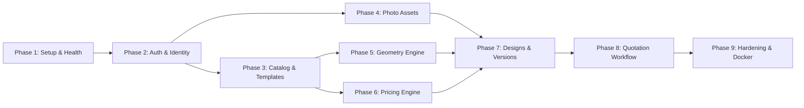

# SAF Studio: Backend Master Plan & Executive Summary

**Author:** Senior Backend Architect, Python/FastAPI Engineer & Application Security Specialist  
**Audience:** Technical Leadership & Project Stakeholders  
**Date of Audit:** November 7, 2026  
**Status:** **ANALYSIS & PLANNING COMPLETE — AWAITING USER APPROVAL TO BEGIN IMPLEMENTATION**

---

## 1. Executive Summary

This Master Plan establishes the definitive, production-ready backend architecture for **SAF Studio**, derived directly from an in-depth audit of the existing React 19 frontend codebase (`frontend/src/`).

The proposed backend is a **FastAPI Pragmatic Modular Monolith** on **Python 3.12+** backed by **MongoDB 7.0+** using the official asynchronous driver (`PyMongo Async` / `Motor`), **Pydantic v2** validation, and secure **JWT authentication with httpOnly cookie refresh rotation**.

All 9 detailed planning deliverables have been generated in `docs/backend-planning/`:
1. `01_FRONTEND_ANALYSIS.md` — Complete frontend feature and workflow inventory.
2. `02_BACKEND_REQUIREMENTS.md` — Backend functionality grouped by module.
3. `03_API_SPECIFICATION.md` — Every API endpoint with request/response examples (31 endpoints).
4. `04_DATABASE_DESIGN.md` — MongoDB collections, schemas, indexes, and relationships (11 collections).
5. `05_SECURITY_AND_BUG_AUDIT.md` — Evidence-based security, contract, and bug audit.
6. `06_BACKEND_ARCHITECTURE.md` — FastAPI structure and engineering conventions.
7. `07_COMPLEXITY_AND_ESTIMATES.md` — Route classification and effort estimates.
8. `08_IMPLEMENTATION_PHASES.md` — Dependency-aware backend development roadmap (9 phases).
9. `09_INTEGRATION_AND_TESTING.md` — Frontend integration, verification, and deployment strategy.

---

## 2. Key Architecture Metrics & Overview

### 2.1 Scope & Totals
- **Total Proposed API Endpoints:** **31 endpoints** (All prefixed with `/api/v1`).
- **Total Functional Modules:** **9 modules**.
- **Total MongoDB Collections:** **11 collections** (`users`, `refresh_tokens`, `frame_materials`, `frame_moldings`, `photos`, `layout_templates`, `designs`, `design_versions`, `quotes`, `pricing_configs`, `audit_logs`).
- **Total Estimated Effort Range:** **118 – 150 developer-hours (~3.0 – 3.5 developer-weeks)**.

### 2.2 Endpoints by Functional Module
| # | Functional Module | Endpoint Count | Easy | Medium | Hard | Estimated Effort |
|---|---|---|---|---|---|---|
| 1 | **Authentication & Identity** | 7 | 3 | 4 | 0 | 24.0 h |
| 2 | **Frame Catalog & Materials** | 2 | 2 | 0 | 0 | 4.5 h |
| 3 | **Layout Templates Catalog** | 1 | 1 | 0 | 0 | 2.5 h |
| 4 | **Photograph Management** | 5 | 2 | 3 | 0 | 17.0 h |
| 5 | **Geometry Engine & Validation** | 2 | 0 | 0 | 2 | 18.0 h |
| 6 | **Dynamic Pricing Engine** | 1 | 0 | 1 | 0 | 7.0 h |
| 7 | **Designs & Version History** | 6 | 5 | 1 | 0 | 16.5 h |
| 8 | **Quotation Requests Workflow** | 4 | 2 | 1 | 1 | 15.0 h |
| 9 | **System, Health & Operations** | 3 | 3 | 0 | 0 | 3.0 h |
| | **Totals** | **31** | **18** | **10** | **3** | **107.5 h (Coding & Testing)** |
| | *Foundational Setup & Security Hardening* | | | | | **+20.0 h** |
| | **Grand Total** | | | | | **127.5 h (~118 – 150 h)** |

### 2.3 Complexity Breakdown
- **Easy (18 endpoints — 58%):** Basic CRUD, read-only catalog queries, health pings, single-document retrieval.
- **Medium (10 endpoints — 32%):** Multi-identifier login, Argon2id hashing, token rotation, multipart photo uploads, WebP image processing, dynamic linear pricing formulas.
- **Hard (3 endpoints — 10%):**
  1. `EP-GEO-01` (`POST /geometry/validate-layout`): 2D AABB floating-point collision detection.
  2. `EP-GEO-02` (`POST /geometry/generate-layout`): Algorithmic multi-style layout solvers.
  3. `EP-QUOTE-01` (`POST /quotes`): Multi-document transactional quote creation with atomic sequential numbering (`QT-YYYY-XXXX`).
- **Very Hard (0 endpoints — 0%):** No high-risk distributed consensus or machine learning components are required.

---

## 3. Recommended Implementation Sequence

Implementation is structured across **9 dependency-aware phases**:

1. **Phase 1: Foundation & Health** (`EP-SYS-01`, `EP-SYS-02`) — FastAPI skeleton, async MongoDB lifespan, error envelope, health probes.
2. **Phase 2: Authentication & Identity** (`EP-AUTH-01` to `07`) — Multi-identifier login (email/phone), Argon2id, JWT, refresh rotation cookie, `/auth/me`.
3. **Phase 3: Catalog & Templates** (`EP-CAT-01`, `02`, `EP-TMPL-01`) — Read-only frame materials, moldings with hex swatches, curated templates.
4. **Phase 4: Photograph Management** (`EP-PHOTO-01` to `05`) — Multipart upload, Pillow resize (WebP thumbnail/preview), HMAC signed streaming for `` tags.
5. **Phase 5: Geometry Engine** (`EP-GEO-01`, `02`) — Layout validation, collision detection (200 OK with `is_valid: false`), layout generation.
6. **Phase 6: Dynamic Pricing Engine** (`EP-PRICE-01`) — Linear moulding inches, matboard area, UV glass, Indian GST (18%), postal PIN code shipping.
7. **Phase 7: Gallery Wall Designs & Versions** (`EP-DSGN-01` to `06`) — Design CRUD, version snapshots, user tenancy isolation (BOLA defense).
8. **Phase 8: Quotation Workflow** (`EP-QUOTE-01` to `04`) — Quotation submission, atomic sequence counter, user quotation history, admin review.
9. **Phase 9: Hardening, Rate Limiting & Deployment** — Slowapi rate limits, Docker multi-stage build, automated backup scripts, CI/CD pipeline.

---

## 4. Major Risks & Mitigation Strategies

| Risk Description | Severity | Mitigation Strategy |
|---|---|---|
| **XSS Token Exfiltration (Item Q3)** | **Critical** | Move `refresh_token` from `localStorage` to an `httpOnly`, `Secure`, `SameSite=Lax` cookie. Keep short-lived `access_token` in memory. |
| **Image Tag Auth Paradox (Item Q5)** | **High** | Browser `` cannot pass Bearer headers. Backend generates time-limited HMAC-signed URLs (`?sig=...`) for photo streaming. |
| **Image Decompression Bombs** | **High** | Enforce Pillow `Image.MAX_IMAGE_PIXELS = 50_000_000` before decoding to prevent 25 MB files exhausting container memory. |
| **Collision HTTP Status Mismatch (Item Q10)** | **Medium** | Reconcile contract: Return HTTP 200 with `is_valid: false` and collision errors for layout conflicts, avoiding false 422 form crashes. |
| **BOLA / IDOR on User Designs** | **Medium** | Enforce mandatory user ownership predicate (`user_id == current_user.id`) in every repository query on designs, versions, and photos. |
| **Entity ID Type Discrepancy (Item Q1)** | **Low** | Update frontend TypeScript `EntityId` from `number` to `string`, matching MongoDB 24-character hexadecimal `ObjectId`. |

---

## 5. Architectural Decisions Requiring User Approval

Before initiating backend code development in the `backend/` directory, please review and confirm the following key design decisions:

1. **Refresh Token Transport via `httpOnly` Cookie:**
   - *Proposal:* Transition the persistent `refresh_token` from `localStorage` to an `httpOnly`, `Secure`, `SameSite=Lax` cookie, while retaining the short-lived `access_token` in memory via `apiClient.ts`.
   - *Alternative:* Retain both tokens in `localStorage` (higher XSS exposure, simpler client).
   - *Recommendation:* **Approve httpOnly cookie.**

2. **Photo URL Authorization Strategy:**
   - *Proposal:* Implement HMAC-signed query tokens (`/photos/{id}/preview?sig=...&expires=...`) for photo streaming so standard browser `` and SVG `<image>` tags render without custom headers.
   - *Alternative:* Require session cookies for all media requests.
   - *Recommendation:* **Approve signed query URLs.**

3. **Geometry Collision Response Contract (Item Q10):**
   - *Proposal:* Return HTTP 200 with `is_valid: false` and item collision details in the `errors[]` array when frames overlap, reserving HTTP 422 strictly for malformed JSON payloads.
   - *Recommendation:* **Approve 200 OK collision response.**

4. **Entity ID Format Standardization (Item Q1):**
   - *Proposal:* Standardize all entity IDs as MongoDB 24-character hexadecimal string representations, updating frontend `EntityId` from `number` to `string`.
   - *Recommendation:* **Approve string hex IDs.**

---

## 6. Current Status & Next Steps

**THIS PHASE IS COMPLETE.**  
No backend application code, frontend modifications, or dependencies have been altered.

**Awaiting User Direction:**  
Once you review and approve these architecture documents and decisions, we will immediately proceed with **Phase 1: Project Setup, Async MongoDB Connection & Core Health Endpoints**.

