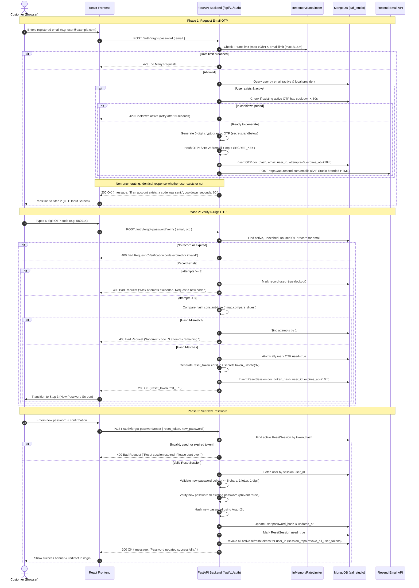

# SAF Studio — Email OTP Password Recovery: Analysis & Architecture Planning

**Document Version:** 1.0.0  
**Status:** Approved Architecture Plan (Analysis Only — Awaiting Implementation Prompt)  
**Date:** 2026-11-07  
**Author:** SAF Studio Core Architecture Team  

---

## Executive Summary

This document presents the finalized architecture to replace the previously proposed mobile SMS OTP password recovery with a **secure, production-ready Email OTP password recovery flow powered by Resend's free tier**.

The design maintains complete fidelity to SAF Studio's existing dual-identifier authentication (supporting both Indian mobile numbers `+91` and emails for Sign-In and Registration), while restricting password recovery to registered email addresses. This completely eliminates third-party SMS carrier dependency, bypasses Indian TRAI DLT regulatory friction, and leverages Resend’s modern transactional email delivery within its free tier (3,000 emails/month).

---

## 1. Existing Implementation Audit & Findings

A comprehensive audit of the backend, frontend, database, and security layers reveals substantial reusable infrastructure alongside specific gaps:

### 1.1 Backend Authentication State
* **Existing Route (`backend/app/api/v1/endpoints/auth.py`):**
  * Endpoint `POST /api/v1/auth/forgot-password` (EP-AUTH-06) is currently registered with schema `ForgotPasswordRequest(email: EmailStr)` and returns a generic `ForgotPasswordResponse`.
  * **Current implementation:** Calls `auth_service.initiate_password_recovery()`, which queries MongoDB for the user, generates a 32-byte URL-safe token, hashes it with SHA-256, and stores it in `session_repo.create_password_reset()`.
  * **Identified Gap:** It does **not** send an email (comment notes `# delivery via configured SMTP`), does not generate a 6-digit OTP, has no OTP verification route, and has no password reset completion route (`/auth/reset-password`).
* **Existing Security Primitives (`backend/app/core/security.py`):**
  * `hash_password(password: str) -> str`: Argon2id with NIST/OWASP parameters (`time_cost=3`, `memory_cost=65536`, `parallelism=4`, `type=ID`).
  * `verify_password(plain: str, hashed: str) -> bool`: Constant-time Argon2id verification.
  * `hash_token(raw_token: str) -> str`: Cryptographic SHA-256 hashing.
  * `generate_secure_token(nbytes: int = 32) -> str`: Cryptographic URL-safe randomness via `secrets`.
* **Rate Limiting (`backend/app/services/rate_limiter.py`):**
  * `InMemoryRateLimiter`: Thread-safe sliding-window rate limiter already protecting login (`5/300s`) and registration (`5/300s`).
  * Can be directly used to enforce per-IP and per-email OTP request caps, plus a 60-second cooldown.

### 1.2 MongoDB Schema & Repository State
* **Existing Collection `password_resets` (`backend/app/models/session.py`):**
  * Document `PasswordResetInDB`:
    ```python
    id: PyObjectId
    user_id: PyObjectId
    token_hash: str
    expires_at: datetime
    used: bool = False
    created_at: datetime
    ```
  * Repository `SessionRepository` (`backend/app/repositories/session_repository.py`):
    * Already manages `password_resets` collection.
    * Indexes: `idx_reset_token_hash_unique` (unique on `token_hash`) and `idx_password_resets_ttl` (`expires_at` with `expireAfterSeconds=0`).
    * Already contains `revoke_all_user_tokens(user_id)` to terminate all active refresh token sessions upon credential change.
  * **Required Extension:** Extend `PasswordResetInDB` (or add purpose-specific fields) to store the hashed 6-digit OTP, attempt count (`attempts: int`), resend lock timestamp (`resend_available_at: datetime`), and purpose tag (`purpose: "email_otp" | "password_reset_session"`).

### 1.3 Frontend State
* **Existing Page (`frontend/src/features/auth/pages/ForgotPasswordPage.tsx`):**
  * Currently a static placeholder displaying an `Alert` ("Online password reset is coming soon...") wrapped in `AuthLayout` (`hero={authAssets.login.backdrop}`).
  * Route `ROUTES.forgotPassword = '/forgot-password'` already wired in React Router.
* **Reusable UI Building Blocks:**
  * `AuthLayout`, `AuthHeader`, `AuthSwitchPrompt`, `Input`, `Button`, `Alert`, and `InlineNotice`.
  * `useForm` hook (`frontend/src/hooks/useForm.ts`) with field-level blur/submit validation.
  * Limits & regex helpers in `frontend/src/features/auth/lib/` (`isEmail`, `AUTH_LIMITS`, `PASSWORD_HINT`).
* **Untouched Functionality:**
  * `LoginPage.tsx` and `RegisterPage.tsx` support both email and Indian mobile numbers (`+91`). This dual-identifier logic will remain 100% intact.

---

## 2. Recommended Architecture & Complete User Flow

We recommend a **Three-Phase State Machine** tied together by a short-lived, single-use **Reset Session Token (RST)**.

### 2.1 Why the Reset Session Token (RST) Pattern?
Rather than sending email, OTP, and new password all in one monolithic request (bad UX) or persisting unverified password draft state, the flow decouples into:
1. **Verification Phase:** OTP verifies ownership of the email.
2. **Exchange:** Backend issues an ephemeral, high-entropy `reset_token` (valid for 10 minutes) directly to the verified client.
3. **Execution Phase:** Client submits the `reset_token` with the new password. The backend verifies the token atomically, updates the password, and revokes the token.

### 2.2 Complete Flow Sequence Diagram



---

## 3. Proposed Backend APIs & Contracts

All endpoints live under the `/api/v1/auth/forgot-password` namespace to group recovery actions logically.

### 3.1 Endpoint 1: Initiate / Request OTP

* **HTTP Route:** `POST /api/v1/auth/forgot-password`
* **Access:** Public (Rate-limited)
* **Purpose:** Validates email format, checks rate limits, generates OTP, sends branded email via Resend, and returns a non-enumerating generic response.

#### Request Payload:
```json
{
  "email": "customer@example.com"
}
```

#### Response Payloads:
* **200 OK (Standard Non-Enumerating Response):**
  ```json
  {
    "message": "If an account is associated with this email, a 6-digit verification code has been sent.",
    "cooldown_seconds": 60
  }
  ```
* **422 Unprocessable Entity (Invalid Email Syntax):**
  ```json
  {
    "detail": [
      {
        "field": "email",
        "issue": "Enter a valid email address."
      }
    ]
  }
  ```
* **429 Too Many Requests (Rate Limit or Cooldown Active):**
  ```json
  {
    "detail": {
      "code": "RATE_LIMIT_EXCEEDED",
      "message": "Please wait 45 seconds before requesting another verification code."
    }
  }
  ```

---

### 3.2 Endpoint 2: Verify OTP & Issue Reset Session Token

* **HTTP Route:** `POST /api/v1/auth/forgot-password/verify`
* **Access:** Public (Rate-limited: max 5 attempts per IP per 5 min)
* **Purpose:** Validates the 6-digit OTP against the stored cryptographic hash, enforces a 3-attempt ceiling, and issues an ephemeral `reset_token`.

#### Request Payload:
```json
{
  "email": "customer@example.com",
  "otp": "582914"
}
```

#### Response Payloads:
* **200 OK (Verification Successful):**
  ```json
  {
    "reset_token": "rst_4a8f9c0e2b1d6f8a3c5e7b9d1f3a5c7e9b2d4f6a8c0e2b1d4f6a8c0e2b1d6f8a",
    "expires_in_seconds": 600
  }
  ```
* **400 Bad Request (Incorrect Code with Remaining Attempts):**
  ```json
  {
    "detail": {
      "code": "INVALID_OTP",
      "message": "Incorrect verification code. 2 attempts remaining.",
      "attempts_remaining": 2
    }
  }
  ```
* **400 Bad Request (Max Attempts Exceeded or Expired):**
  ```json
  {
    "detail": {
      "code": "OTP_EXPIRED_OR_LOCKED",
      "message": "Verification code has expired or maximum attempts exceeded. Please request a new code."
    }
  }
  ```

---

### 3.3 Endpoint 3: Submit New Password

* **HTTP Route:** `POST /api/v1/auth/forgot-password/reset`
* **Access:** Public (Protected by single-use `reset_token`)
* **Purpose:** Verifies the `reset_token`, validates password rules, ensures no password re-use, hashes with Argon2id, updates user document, revokes token, and revokes all active sessions.

#### Request Payload:
```json
{
  "reset_token": "rst_4a8f9c0e2b1d6f8a3c5e7b9d1f3a5c7e9b2d4f6a8c0e2b1d4f6a8c0e2b1d6f8a",
  "new_password": "StudioCraft2026!Secure"
}
```

#### Response Payloads:
* **200 OK (Password Reset Successful):**
  ```json
  {
    "message": "Your password has been successfully updated. Please sign in with your new password."
  }
  ```
* **400 Bad Request (Password Policy Violation):**
  ```json
  {
    "detail": {
      "code": "WEAK_PASSWORD",
      "message": "Password must be at least 8 characters and include both a letter and a number."
    }
  }
  ```
* **400 Bad Request (Password Reuse):**
  ```json
  {
    "detail": {
      "code": "PASSWORD_REUSED",
      "message": "New password cannot be the same as your previous password."
    }
  }
  ```
* **401 Unauthorized (Invalid or Expired Reset Token):**
  ```json
  {
    "detail": {
      "code": "INVALID_RESET_SESSION",
      "message": "Your password reset session has expired or is invalid. Please restart recovery."
    }
  }
  ```

---

## 4. MongoDB Schema & Security Strategy

### 4.1 Reusing the `password_resets` Collection
To avoid collection bloat, the existing `password_resets` collection will store both **Email OTP challenges** and **Reset Session Tokens**, distinguished by the `purpose` discriminator:

```
                  ┌──────────────────────────────────────────────┐
                  │       MongoDB: `password_resets` Table       │
                  └──────────────────────────────────────────────┘
                                          │
            ┌─────────────────────────────┴─────────────────────────────┐
            ▼                                                           ▼
    purpose: "email_otp"                                purpose: "password_reset_session"
  • _id: ObjectId                                     • _id: ObjectId
  • user_id: ObjectId                                 • user_id: ObjectId
  • email: "customer@example.com"                     • token_hash: SHA-256(reset_token)
  • otp_hash: SHA-256(email+otp+salt)                 • attempts: null
  • attempts: 0 (max 3)                               • used: false
  • resend_available_at: ISODate(+60s)                • expires_at: ISODate(+10m)
  • expires_at: ISODate(+10m)                         • created_at: ISODate
  • used: false                                       
```

### 4.2 Document Schemas (Pydantic & PyMongo)

```python
class PasswordResetDocInDB(BaseModel):
    """Unified schema for OTP verifications and reset session tokens."""

    id: PyObjectId = Field(default_factory=lambda: str(ObjectId()), alias="_id")
    user_id: PyObjectId
    email: str | None = None
    token_hash: str  # Stores SHA-256 of OTP or SHA-256 of reset_token
    purpose: Literal["email_otp", "password_reset_session"]
    attempts: int = 0
    max_attempts: int = 3
    resend_available_at: datetime | None = None
    expires_at: datetime
    used: bool = False
    created_at: datetime = Field(default_factory=lambda: datetime.now(UTC))
```

### 4.3 Database Indexes (`SessionRepository.create_indexes`)
1. **TTL Index (Automatic Cleanup):**
   `IndexModel([("expires_at", ASCENDING)], expireAfterSeconds=0, name="idx_password_resets_ttl")` (Already exists).
2. **Token Hash Lookup Index:**
   `IndexModel([("token_hash", ASCENDING)], unique=True, name="idx_reset_token_hash_unique")` (Already exists).
3. **Compound Email + Purpose Index (New):**
   `IndexModel([("email", ASCENDING), ("purpose", ASCENDING), ("used", ASCENDING)], name="idx_resets_email_active")` for fast query of the active OTP document for a given email.

### 4.4 Cryptographic OTP Generation & Storage
* **Generation:** Generated using Python's hardware-backed cryptographic PRNG:
  ```python
  otp_code = f"{secrets.randbelow(900000) + 100000}"  # Strict 6 digits: 100000 - 999999
  ```
* **Storage Hashing:** Plaintext OTP is **never** written to database or logs. The database stores:
  ```python
  otp_hash = hashlib.sha256(f"{email.lower().strip()}:{otp_code}:{settings.SECRET_KEY}".encode()).hexdigest()
  ```
  Binding the hash to the customer's email and the application `SECRET_KEY` prevents cross-account token replay.
* **Constant-Time Verification:** Hash comparison is evaluated using `hmac.compare_digest(stored_hash, candidate_hash)` to eliminate timing side-channel attacks.

### 4.5 Brute-Force & Replay Defenses
* **Max 3 Attempts:** Verification executes an atomic MongoDB `$inc: {"attempts": 1}`. If `attempts >= 3`, the document is immediately updated with `used: true`, terminating the OTP.
* **Single-Use Consumption:** Upon successful verification, the record is immediately transitioned to `used: true` in the same operation.
* **60-Second Cooldown:** Before generating a new OTP, the backend checks whether an active OTP for that email has `resend_available_at > now`. If so, it rejects the request with HTTP 429.
* **Rate Limits via `InMemoryRateLimiter`:**
  * Per-Email: Maximum 3 OTP requests per 15 minutes.
  * Per-IP: Maximum 10 OTP requests per hour (mitigates distributed spam and toll fraud).
* **Full Session Revocation:** Upon resetting password, `SessionRepository.revoke_all_user_tokens(user_id)` is executed, marking all active refresh tokens for the user as `is_revoked: True`. Any existing session on desktop/mobile is immediately invalidated on next refresh.

---

## 5. Resend Integration & Configuration Requirements

### 5.1 Why Resend?
* **Generous Free Tier:** **3,000 emails per month** (100 emails/day), with 1 custom verified domain.
* **Exceptional Deliverability:** Built directly atop AWS SES infrastructure with dedicated IP pools for transactional delivery.
* **Zero Infrastructure Overhead:** Pure REST API over HTTPS; no SMTP server connection pooling, TLS handshake overhead, or firewall port 587/465 blocks.

### 5.2 Python Integration Architecture
To keep the application lightweight, modern, and non-blocking, we recommend invoking Resend via **`httpx.AsyncClient`** rather than adding a synchronous third-party SDK:
1. `httpx` is already part of the project's dependency set.
2. It natively supports Python 3.12 `async/await`, executing without blocking the FastAPI uvicorn event loop.
3. Resend's REST endpoint is clean and standardized: `POST https://api.resend.com/emails`.

```python
# Direct asynchronous Resend client implementation outline
async def send_otp_email(to_email: str, otp_code: str) -> bool:
    settings = get_settings()
    if not settings.RESEND_API_KEY or settings.ENVIRONMENT == "development":
        logger.info("[DEV EMAIL] OTP for %s: %s", to_email, otp_code)
        return True

    payload = {
        "from": settings.RESEND_FROM_EMAIL,
        "to": [to_email],
        "subject": f"{otp_code} is your SAF Studio verification code",
        "html": render_otp_email_html(otp_code),
        "text": render_otp_email_text(otp_code),
    }

    async with httpx.AsyncClient(timeout=5.0) as client:
        resp = await client.post(
            "https://api.resend.com/emails",
            headers={"Authorization": f"Bearer {settings.RESEND_API_KEY}"},
            json=payload,
        )
        return resp.status_code in (200, 201)
```

### 5.3 Configuration Settings (`app/core/config.py`)
Add the following settings to the `Settings` class:
```python
# Resend Email Configuration
RESEND_API_KEY: str = Field(
    default="",
    description="Resend REST API Bearer key (re_...)",
)
RESEND_FROM_EMAIL: str = Field(
    default="SAF Studio <onboarding@resend.dev>",
    description="Verified sender email for transactional emails",
)
EMAIL_OTP_EXPIRE_MINUTES: int = Field(
    default=10,
    description="Validity window for 6-digit email OTP codes",
)
EMAIL_OTP_COOLDOWN_SECONDS: int = Field(
    default=60,
    description="Minimum cooldown in seconds between OTP resend requests",
)
```

### 5.4 Domain Verification & Development Fallback
* **Production Deployment:**
  * Add the custom domain (e.g. `safstudio.com`) to Resend.
  * Configure 3 DNS records: DKIM (CNAME), SPF (MX/TXT `include:amazonses.com`), and DMARC (`v=DMARC1; p=none;`).
  * Set `RESEND_FROM_EMAIL="SAF Studio <security@safstudio.com>"`.
* **Local Development & Testing:**
  * In `development` mode or whenever `RESEND_API_KEY` is omitted, the `EmailService` logs the OTP directly to the terminal stdout/logs:
    `[DEV EMAIL OTP] Code for user@example.com: 482910`
  * This guarantees automated tests and local developer workflows run completely offline with zero external network dependencies.
  * Developers using a free Resend key without a custom domain can use `onboarding@resend.dev` to deliver emails to their single registered Resend account email.

---

## 6. Frontend Component-Level Modification Plan

The user interface lives in `frontend/src/features/auth/pages/ForgotPasswordPage.tsx` inside the existing `AuthLayout` (`hero={authAssets.login.backdrop}`).

### 6.1 State Machine UI Structure

```
                  ┌──────────────────────────────────────────────┐
                  │           ForgotPasswordPage.tsx             │
                  └──────────────────────────────────────────────┘
                                          │
            ┌─────────────────────────────┼─────────────────────────────┐
            ▼                             ▼                             ▼
       [ Step 1 ]                    [ Step 2 ]                    [ Step 3 ]
     EnterEmailStep                VerifyOtpStep               NewPasswordStep
  • Email input                 • 6-digit PIN input           • New password field
  • Client validation           • Auto-focus & advance        • Confirm password
  • "Send Code" CTA             • 60s live countdown          • Real-time strength hint
  • Back to Sign In             • "Resend Code" button        • Show/Hide password eye
                                • "Change email" back-link    • "Update Password" CTA
```

### 6.2 Component Inventory & Changes

| File | Change Type | Description |
| :--- | :--- | :--- |
| `frontend/src/features/auth/pages/ForgotPasswordPage.tsx` | **Refactor** | Replaces the alert placeholder with the 3-step state machine coordinator. |
| `frontend/src/features/auth/components/OtpInput.tsx` | **New** | Accessible 6-digit OTP input component with auto-advance, backspace focus shifting, paste support (`onPaste`), and ARIA numeric keypad support (`inputMode="numeric"`). |
| `frontend/src/features/auth/components/ForgotPasswordFlow.tsx` | **New** | Step renderer handling transitions, loading spinners, and error alerts. |
| `frontend/src/features/auth/hooks/useForgotPassword.ts` | **New** | Custom React hook managing the step state (`'email' \| 'otp' \| 'password' \| 'success'`), the 60s cooldown timer, `reset_token` memory storage, API dispatching, and error handling. |
| `frontend/src/features/auth/lib/forgotPasswordValidation.ts` | **New** | Validation helpers matching SAF Studio's existing auth limits (validates email syntax, 6-digit OTP regex `^\d{6}$`, and new password policy matching `registerValidation.ts`). |
| `frontend/src/services/endpoints.ts` | **Update** | Add `auth.forgotPassword`, `auth.verifyOtp`, and `auth.resetPassword` routes. |

### 6.3 OTP Input UX Specifications
1. **Auto-Advance:** Typing a digit automatically transfers keyboard focus to the next box.
2. **Backspace Handling:** Pressing Backspace on an empty box shifts focus to the previous box and clears it.
3. **Clipboard Paste:** Pasting a 6-digit string (`e.g. 582914`) fills all 6 boxes simultaneously and triggers auto-submit.
4. **Mobile Usability:** `pattern="[0-9]*"`, `inputMode="numeric"`, `autoComplete="one-time-code"` to trigger native iOS/Android OTP suggestion keyboards.
5. **Cooldown Countdown:** A visual timer displaying `Resend code in 0:45` which transitions into an active, clickable `Resend Code` link when 0 is reached.

---

## 7. Email Template Design

The email must reflect SAF Studio’s luxury aesthetic: deep dark charcoal tones (`#141414`), warm gold framing accents (`#C5A880`), clean typography, and unambiguous security notices.

### 7.1 HTML Email Template (`backend/app/templates/email/otp_recovery.html`)

```html
<!DOCTYPE html>
<html lang="en">
<head>
  <meta charset="utf-8">
  <meta name="viewport" content="width=device-width, initial-scale=1.0">
  <title>Your SAF Studio Verification Code</title>
  <style>
    body { margin: 0; padding: 0; background-color: #0F0F11; font-family: -apple-system, BlinkMacSystemFont, 'Segoe UI', Roboto, Helvetica, Arial, sans-serif; color: #E5E5E7; }
    .wrapper { width: 100%; max-width: 560px; margin: 40px auto; background-color: #1A1A1E; border-radius: 12px; border: 1px solid #2C2C32; overflow: hidden; }
    .header { padding: 32px 40px; text-align: center; border-bottom: 1px solid #2C2C32; }
    .brand-title { font-size: 20px; font-weight: 600; letter-spacing: 2px; color: #FFFFFF; text-transform: uppercase; margin: 0; }
    .brand-subtitle { font-size: 11px; letter-spacing: 1.5px; color: #C5A880; text-transform: uppercase; margin-top: 6px; }
    .content { padding: 40px; text-align: center; }
    .title { font-size: 22px; font-weight: 500; color: #FFFFFF; margin: 0 0 12px; }
    .description { font-size: 14px; line-height: 22px; color: #A1A1AA; margin: 0 0 32px; }
    .otp-container { display: inline-block; background-color: #24242A; border: 1px solid #3F3F46; border-radius: 8px; padding: 16px 36px; margin-bottom: 32px; }
    .otp-code { font-family: 'SF Mono', Monaco, Consolas, monospace; font-size: 36px; font-weight: 700; letter-spacing: 8px; color: #E4C89F; margin: 0; }
    .expiry-note { font-size: 13px; color: #71717A; margin-bottom: 24px; }
    .security-callout { background-color: #202026; border-left: 3px solid #C5A880; padding: 14px 18px; text-align: left; border-radius: 0 6px 6px 0; margin-bottom: 20px; }
    .security-text { font-size: 12px; line-height: 18px; color: #A1A1AA; margin: 0; }
    .footer { padding: 24px 40px; text-align: center; font-size: 12px; color: #52525B; border-top: 1px solid #2C2C32; }
  </style>
</head>
<body>
  <div class="wrapper">
    <div class="header">
      <div class="brand-title">Sagar Arts &amp; Frames</div>
      <div class="brand-subtitle">Fine Art &amp; Memory Wall Studio</div>
    </div>
    <div class="content">
      <h1 class="title">Password Reset Verification</h1>
      <p class="description">We received a request to reset the password for your SAF Studio account. Use the verification code below to complete your recovery:</p>
      
      <div class="otp-container">
        <div class="otp-code">{{ otp_code }}</div>
      </div>
      
      <p class="expiry-note">This code will expire in <strong>10 minutes</strong>. Do not share this code with anyone.</p>
      
      <div class="security-callout">
        <p class="security-text"><strong>Didn’t request this?</strong> If you didn't ask to reset your password, you can safely ignore this email. Your current password remains active and secure.</p>
      </div>
    </div>
    <div class="footer">
      &copy; 2026 Sagar Arts &amp; Frames Studio. All rights reserved.<br>
      This is an automated security transmission. Replies to this email are not monitored.
    </div>
  </div>
</body>
</html>
```

### 7.2 Plain-Text Fallback
```text
SAF STUDIO — PASSWORD RESET CODE
------------------------------------------------------
Your 6-digit verification code is: {{ otp_code }}

This code expires in 10 minutes.

If you did not request a password reset, please ignore this email.
Your account remains secure.

— Sagar Arts & Frames Studio
```

---

## 8. File-by-File Implementation Roadmap

When authorized to implement, the work will be executed across the following files:

### 8.1 Backend Scope

```
backend/
├── app/
│   ├── core/
│   │   ├── config.py                 # ADD: RESEND_API_KEY, RESEND_FROM_EMAIL, EMAIL_OTP_* settings
│   │   └── security.py               # ADD: generate_otp(), hash_otp(), verify_otp()
│   ├── models/
│   │   └── session.py                # EXTEND: PasswordResetInDB with purpose, attempts, cooldown
│   ├── repositories/
│   │   ├── session_repository.py     # ADD: get_active_otp(), increment_otp_attempts(), mark_otp_used()
│   │   └── user_repository.py        # ADD: update_password(user_id, password_hash)
│   ├── schemas/
│   │   └── auth.py                   # ADD: VerifyOtpRequest, ResetPasswordRequest, extend ForgotPassword
│   ├── services/
│   │   ├── email_service.py          # NEW: Resend client with HTML rendering & dev mock
│   │   └── auth_service.py           # IMPLEMENT: verify_recovery_otp(), reset_password_with_token()
│   └── api/v1/endpoints/
│       └── auth.py                   # UPDATE: /forgot-password, ADD: /forgot-password/verify, /forgot-password/reset
└── tests/
    └── api/
        └── test_auth_forgot_password.py # NEW: Comprehensive pytest suite covering all 3 phases
```

### 8.2 Frontend Scope

```
frontend/
├── src/
│   ├── config/
│   │   └── routes.ts                 # VERIFY: ROUTES.forgotPassword (already present)
│   ├── services/
│   │   └── endpoints.ts              # ADD: auth.forgotPassword, auth.verifyOtp, auth.resetPassword
│   └── features/
│       └── auth/
│           ├── components/
│           │   ├── OtpInput.tsx      # NEW: Accessible 6-digit digit input box
│           │   └── ForgotPasswordFlow.tsx # NEW: Form stepper component
│           ├── hooks/
│           │   └── useForgotPassword.ts # NEW: Custom state hook for countdown, steps & submit
│           ├── lib/
│           │   └── forgotPasswordValidation.ts # NEW: Field validators matching auth policies
│           └── pages/
│               └── ForgotPasswordPage.tsx # REFACTOR: Replace placeholder alert with ForgotPasswordFlow
```

---

## 9. Testing Strategy, Risks & Mitigations

### 9.1 Verification Test Matrix

| Test Case | Scenario | Expected Behavior |
| :--- | :--- | :--- |
| **TC-01** | Valid registered email | Returns 200 OK, creates OTP record in DB with SHA-256 hash, dispatches email via Resend (or dev console). |
| **TC-02** | Unregistered email | Returns identical 200 OK non-enumerating message; no OTP generated; no email sent. |
| **TC-03** | Resend cooldown enforcement | Requesting an OTP within 60 seconds of a previous request returns 429 Too Many Requests with countdown. |
| **TC-04** | Valid OTP verification | Submitting correct 6 digits returns 200 OK + `reset_token`, marks OTP record `used: true`. |
| **TC-05** | Incorrect OTP verification | Submitting wrong code increments `attempts` to 1, returns 400 Bad Request with remaining attempts. |
| **TC-06** | OTP brute force lockout | After 3 wrong OTP attempts, OTP is permanently invalidated (`used: true`); further attempts return 400 locked. |
| **TC-07** | Expired OTP | Attempting verification after 10 minutes returns 400 Expired. |
| **TC-08** | Password reset execution | Submitting valid `reset_token` and conforming password updates Argon2id hash in DB and returns 200 OK. |
| **TC-09** | Password reuse rejection | Submitting the customer's existing password returns 400 Bad Request ("Cannot be same as previous"). |
| **TC-10** | Session token single-use | Re-using the same `reset_token` returns 401 Unauthorized / Invalid Token. |
| **TC-11** | Session revocation check | After password reset, all previously issued refresh tokens for the user in `refresh_tokens` are revoked. |

### 9.2 Risks & Mitigations

1. **Risk: Resend Free Tier Limit (100 emails/day, 3,000/month)**
   * *Mitigation:* Strict sliding-window rate limiting on the backend (max 3 OTP requests per email per 15 minutes, 10 per IP per hour) prevents malicious actors from exhausting the quota via automation.
2. **Risk: Email Deliverability & Spam Folder Placement**
   * *Mitigation:* Production domain requires complete SPF, DKIM, and DMARC alignment. The email template includes a clean plain-text alternative, high text-to-HTML ratio, and explicit transactional security headers.
3. **Risk: Accidental Breaking of Mobile Sign-In**
   * *Mitigation:* `LoginRequest` and `RegisterRequest` remain completely unaltered. Mobile normalization (`_INDIAN_MOBILE_RE = re.compile(r"^[6-9]\d{9}$")`) and phone authentication logic are untouched.
4. **Risk: Network Downtime or Resend API Failure**
   * *Mitigation:* The `EmailService` sets a strict 5.0s timeout with structured exception handling. If Resend fails, the backend logs the error cleanly and surfaces a user-friendly message without leaking stack traces.

---

## 10. Conclusion & Final Recommendation

The **Email OTP with Resend** approach delivers a vastly superior developer experience and customer security profile compared to SMS:
* Zero ongoing carrier SMS charges and zero Indian DLT telecom regulatory friction.
* 3,000 free transactional emails per month via Resend.
* Clean 3-step UX in SAF Studio's existing design system.
* Complete protection against brute force, replay attacks, account enumeration, and session hijacking.

**Status:** Architecture and planning are complete. All specifications are finalized. Awaiting user confirmation to proceed with implementation in the next prompt.

