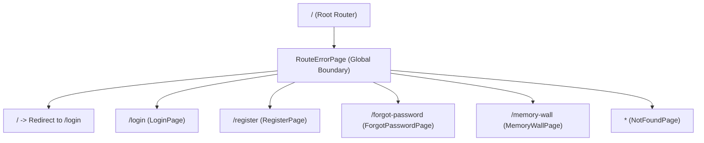
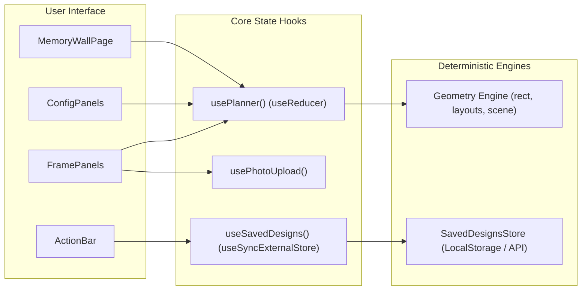
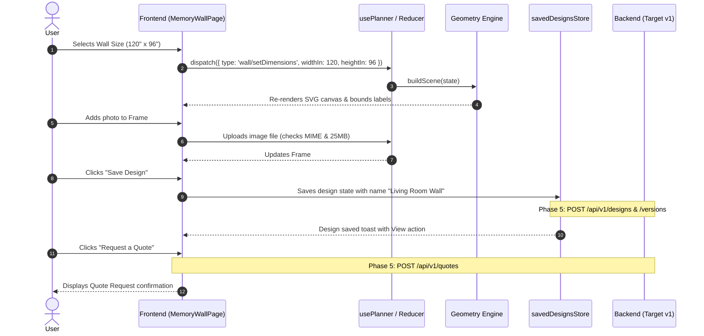

# Phase 1: Complete Frontend Analysis & Workflow Inventory

**Project:** SAF Studio (Memory Wall & Custom Framing Web Platform)  
**Frontend Path:** `C:\Users\sonawhri\OneDrive - Schaeffler Pre-Merger\Documents\SAF Studio Project\frontend`  
**Frontend Architecture:** React 19.3.1, TypeScript 7.0.2 (strict), Tailwind CSS v4, Vite 8.3.6, React Router v7  
**Test Suite:** Vitest 5.1.0, 312 passing automated tests (100% clean check)  
**Date of Audit:** November 7, 2026  
**Status:** Comprehensive Analysis Complete

---

## 1. Executive Summary & Architecture Overview

SAF Studio is a high-precision, client-side rich web application for interactive photo gallery wall curation and custom framing quotation. It is designed as a sister brand client sharing the core business logic, contracts, and state pipelines with the reference Moonlight Photo Studio platform, while delivering an upgraded luxury aesthetic.

The frontend application is currently operating in an **analysis and UI-tested stage (Phases 0–4 complete)**, featuring:
1. Complete authentication UI (Login, Register, Forgot Password placeholder).
2. Fully interactive Memory Wall Planner with deterministic geometry solving, real-time bounding box calculation, wall configuration, frame customisation, and high-resolution export.
3. Decoupled API abstraction layer (`src/services/apiClient.ts`, `src/services/endpoints.ts`, `src/services/tokenStorage.ts`) and strict wire-contract TypeScript types (`src/types/api/*`).
4. Standalone mock storage and stub implementations (`mockAuth.ts`, `savedDesigns.ts`) ready for drop-in backend connection (Phase 5).

---

## 2. Routes, Pages, Layouts, and Navigation

The frontend employs React Router v7 with code-split lazy routes wrapped in a root error boundary.



### Route Inventory

| Path | Component File | Auth Requirement | Layout Shell | Key User Workflows |
|---|---|---|---|---|
| `/` | `src/app/router.tsx` | Public | None | Immediate 302/Replace redirect to `/login`. |
| `/login` | `src/features/auth/pages/LoginPage.tsx` | Public (Guest) | `AuthLayout` (split-screen / backdrop with `login.png`) | Sign in with email or Indian mobile phone + password; Google OAuth trigger; links to register and password reset. |
| `/register` | `src/features/auth/pages/RegisterPage.tsx` | Public (Guest) | `AuthLayout` (split-screen / backdrop with `register.png`) | Register with full name, email, 10-digit mobile, and password; Google OAuth trigger; link to login. |
| `/forgot-password` | `src/features/auth/pages/ForgotPasswordPage.tsx` | Public (Guest) | `AuthLayout` (login backdrop) | Informational placeholder directing user to studio support pending password reset API. |
| `/memory-wall` | `src/features/memory-wall/pages/MemoryWallPage.tsx` | Public / Hybrid (Auth needed for save/quote) | BrandBar + Sticky Hero Strip + Multi-panel grid + Action Bar | 4-step interactive wall curation: Wall setup, layout style selection, frame customisation (opening size, moulding finish, mat mount, orientation, photo), preview, design save, quote request. |
| `*` | `src/app/NotFoundPage.tsx` | Public | BrandBar + Centered card | 404 recovery page offering navigation back to `/memory-wall` or `/login`. |

---

## 3. Component Hierarchy, Dialogs, and Interactive Controls

### 3.1 App Shell & Shared Design System
- **Brand & Shell:**
  - `BrandBar.tsx`: Top navigation bar with logo, brand tag, and user profile action slot.
  - `PageLoader.tsx`: Accessible spinner for lazy chunk loading.
  - `RouteErrorPage.tsx`: Top-level error boundary capturing render exceptions and network chunk crashes.
- **Form Controls & Inputs (`src/components/ui/`):**
  - `TextField.tsx`, `PasswordField.tsx`, `PhoneField.tsx` (enforces fixed `+91` prefix for Indian numbers).
  - `NumberStepper.tsx`: Stepper with bounds clamping and keyboard arrow support.
  - `SegmentedControl.tsx`: Accessible tab-like selector used for units and template categories.
  - `Select.tsx`: Custom native-styled dropdown.
  - `SwatchPicker.tsx`: Accessible color picker supporting smooth paint shades, wood finishes with radial shading, and mount swatches.
  - `Switch.tsx`: Accessible toggle for visual toggles (sofa reference, index badges).
  - `Button.tsx`, `IconButton.tsx`, `Badge.tsx`, `Divider.tsx`.
- **Feedback & Overlay:**
  - `Dialog.tsx`: Modal dialog built with native `<dialog>` or accessible portal, trap focus, and escape key listener.
  - `Toaster.tsx` & `toastContext.ts`: Global notification toast system with auto-dismiss and undo action triggers.
  - `Alert.tsx`: Informational, warning, and error callout banners.

### 3.2 Memory Wall Feature Modules (`src/features/memory-wall/components/`)
1. **Header & Navigation:**
   - `PlannerHeader.tsx`: Houses `BrandBar`, `ProfileMenu` (showing user status, My Saved Templates trigger, sign-out), hero title, and the informational 01–04 `StepStrip`.
2. **Left/Right Configuration Panels (`ConfigPanels.tsx`, `FramePanels.tsx`):**
   - `WallConfigPanel`: Wall dimensions (width: 36–480 in, height: 48–240 in), display unit selector (in, cm, ft), paint shade swatch picker.
   - `LayoutPanel`: Number of frames stepper (1–16), layout style selector (`grid`, `salon`, `centre`, `row`), gap width stepper (0–12 in).
   - `FrameGapsPanel`: Fine-grained spacing adjustment.
   - `AiAssistantPanel`: "Smart Layout Assistant" trigger running heuristic layout fitting with coverage calculation.
   - `FrameSelectionPanel`: Frame list carousel, per-frame sizing (`5x7`, `8x10`, `11x14`, `12x16`, `16x20`), orientation toggle, wood moulding finish (8 swatches), matboard mount toggle/color/margin, photo upload/assignment, and "Apply to all frames" bulk update button.
   - `PreviewSettingsPanel`: Visual overlays (reference sofa, frame numbers, alignment guides).
3. **Canvas Stage (`CanvasPanel.tsx`, `CanvasStage.tsx`, `WallCanvas.tsx`, `WallSvg.tsx`):**
   - Scaled SVG rendering of the wall, shadows, frames, mouldings, mats, sample photos, or user uploads.
   - Dimension lines indicating outer bounds and wall margins.
   - Collision and boundary indicator badges ("Layout exceeds wall boundaries").
4. **Bottom Action Bar (`ActionBar.tsx`):**
   - Desktop floating navigation bar / Mobile fixed bottom dock with 4 actions:
     - `Preview Fullscreen` -> Opens `FullscreenPreviewDialog`.
     - `All Templates` -> Opens `TemplatesDialog`.
     - `My Saved Templates` -> Opens `SavedDesignsDialog`.
     - `Request a Quote` -> Initiates quotation workflow.
5. **Dialog Windows (`dialogs/`):**
   - `FullscreenPreviewDialog.tsx`: Full-screen wall preview with view toggles (sofa, frame index) and high-resolution PNG export (`downloadWallPng`).
   - `TemplatesDialog.tsx`: Browse curated templates filtered by category (`grid`, `salon`, `centre`, `row`) with live compatibility check against current wall dimensions.
   - `SavedDesignsDialog.tsx`: Searchable list of saved wall designs with thumbnail SVG previews, date, item count, and deletion.
   - `SaveDesignDialog.tsx`: Design naming form with warning if session-only uploads are present.

---

## 4. State Management, Data Flow, and Hooks

The frontend avoids heavy third-party state stores (Redux, Zustand) in favor of idiomatic, resilient React primitives:



### State Breakdown

1. **`usePlanner` (`src/features/memory-wall/hooks/usePlanner.ts` & `lib/plannerState.ts`):**
   - Central reducer managing `PlannerState`:
     - `title`: Current design name (default: "My Gallery Wall").
     - `templateId`: Associated template ID or null if custom-modified.
     - `wall`: `{ widthIn, heightIn, paintId }`.
     - `displayUnit`: `'in' | 'cm' | 'ft'`.
     - `layout`: `{ style, gapIn, gapUnit, seed, variant }`.
     - `frames`: Array of up to 16 `FrameConfig` objects (`id`, `sizeId`, `orientation`, `finishId`, `mount`, `photo`).
     - `selectedIndex`: Active frame index for detailed editing.
     - `fillWithSamples`: Boolean indicating whether empty frames display sample images.
     - `preview`: `{ sofa, indexBadges, guides }`.
   - Computes derived `Scene` (`lib/geometry/scene.ts`) on every state transition: calculates individual frame outer dimensions (opening + mat margin * 2 + moulding profile * 2), runs deterministic layout solving, evaluates bounds, checks collisions, and assesses wall fit.
2. **`useSavedDesigns` (`src/features/memory-wall/hooks/useSavedDesigns.ts` & `lib/savedDesigns.ts`):**
   - Implements `useSyncExternalStore` observing `savedDesignsStore`.
   - Currently persists to browser `localStorage` under key `saf.mock.savedDesigns.v1`.
   - Sanitises untrusted storage data with `sanitizePlannerState()` to guard against corrupted or tampered inputs.
3. **`usePhotoUpload` (`src/features/memory-wall/hooks/usePhotoUpload.ts`):**
   - Validates file MIME types (`image/jpeg`, `image/png`, `image/webp`), enforces 25 MB file size limit, decodes natural pixel dimensions via browser `Image`, enforces minimum 300px side dimension, and manages temporary `blob:` URLs with automatic garbage collection on unmount.
4. **`useForm` (`src/hooks/useForm.ts`):**
   - Headless form management driving `LoginForm` and `RegisterForm`.
   - Handles field tracking, blur validation, submission lifecycle, abort signals, and normalized API error mapping.
5. **`tokenStorage` (`src/services/tokenStorage.ts`):**
   - Manages JWT access and refresh tokens.
   - Listens to window `storage` events to synchronize session logout across browser tabs.

---

## 5. Existing API Clients, Contracts, and Hardcoded Data

### 5.1 API Client Abstraction (`src/services/apiClient.ts`)
- Preconfigured HTTP client targeting `VITE_API_BASE_URL` (defaulting to `/api/v1`).
- Automatically attaches `Authorization: Bearer <access_token>` from `tokenStorage`.
- Handles 401 Unauthorized by clearing stored credentials and executing registered notification callbacks.
- Normalizes errors into `ApiError` class matching the standard backend error envelope:
  ```json
  {
    "error": {
      "code": "ERROR_CODE",
      "message": "Human readable message",
      "details": [{ "field": "field_name", "issue": "Specific explanation" }],
      "timestamp": "ISO8601"
    }
  }
  ```
- Implements resilient sanitization so malformed backend error bodies do not crash React rendering.

### 5.2 Hardcoded Static Data (To be reconciled with Backend)
The frontend currently maintains static definitions in `src/features/memory-wall/constants.ts` and `src/features/memory-wall/lib/templates.ts`:
1. **Paint Shades (`PAINT_SHADES`):** 7 swatches (`ivory-mist`, `warm-cream`, `sand`, `peach-blush`, `charcoal`, `stone-grey`, `cloud-grey`).
2. **Wood Mouldings & Finishes (`WOOD_FINISHES`):** 8 finishes (`walnut`, `natural-oak`, `ivory`, `whitewash`, `dark-teak`, `honey`, `golden-teak`, `mahogany`) with profile face widths from 0.875" to 1.125".
3. **Mount Colours (`MOUNT_COLOURS`):** 4 mat colours (`museum-white`, `antique-white`, `black`, `crimson`).
4. **Standard Frame Openings (`FRAME_SIZES`):** 5 sizes (`5x7`, `8x10`, `11x14`, `12x16`, `16x20` inches).
5. **Layout Templates (`TEMPLATES`):** 5 curated presets (`balanced-grid`, `creative-salon`, `centre-focus`, `minimal-row`, `classic-six`).

---

## 6. Detailed User Workflows & Traceability



### Traceability Matrix: User Action to System Components

| Workflow Step | User Interaction | Frontend Component | State Hook / Action | Current Behavior (Phase 4) | Required Backend Operation (Phase 5) |
|---|---|---|---|---|---|
| **Auth 1** | User enters credentials & clicks "Sign In" | `LoginForm.tsx` | `useLoginForm` -> `toLoginRequest()` | 700ms mock delay (`mockAuth.ts`), navigates to `/memory-wall` | `POST /api/v1/auth/login` returning JWT access & refresh tokens |
| **Auth 2** | User submits registration form | `RegisterForm.tsx` | `useRegisterForm` -> `toRegisterRequest()` | 700ms mock delay, navigates to `/memory-wall` | `POST /api/v1/auth/register` validating unique email/phone, returning tokens |
| **Auth 3** | User clicks "Sign Out" | `PlannerHeader.tsx` (`ProfileMenu`) | `tokenStorage.clear()` | Clears tokens, refreshes menu | `POST /api/v1/auth/logout` revoking refresh token session |
| **Wall 1** | Adjusts wall width, height, or unit | `WallConfigPanel` in `ConfigPanels.tsx` | `wall/setDimensions`, `wall/setDisplayUnit` | Clamps to [36–480] x [48–240] in, recalculates scene | Backend geometry validation (`POST /api/v1/geometry/validate-layout`) |
| **Wall 2** | Selects paint shade swatch | `WallConfigPanel` | `wall/setPaint` | Updates SVG background color | Stored in `DesignWall.color_hex` |
| **Layout 1** | Changes layout style (`grid`, `salon`, etc.) | `LayoutPanel` in `ConfigPanels.tsx` | `layout/setStyle` | Runs deterministic solver for style | Backend layout generator (`POST /api/v1/geometry/generate-layout`) |
| **Layout 2** | Changes frame count (1–16) | `LayoutPanel` | `frames/setCount` | Adds/removes frames, regenerates positions | Validated in versions payload |
| **Layout 3** | Clicks "Smart Layout Assistant" | `AiAssistantPanel` | `handleGenerate()` -> `suggestLayouts()` | Computes best arrangement across 4 styles in 450ms | Informs backend layout solver |
| **Frame 1** | Selects frame size or orientation | `FrameSelectionPanel` | `frames/update` | Updates frame geometry, checks bounds | Catalog frame verification |
| **Frame 2** | Selects moulding finish | `FrameSelectionPanel` | `frames/update` or `frames/applyToAll` | Applies wood finish & profile width | Verifies against `GET /api/v1/frames` |
| **Frame 3** | Toggles mat mount & adjusts margin | `FrameSelectionPanel` | `frames/update` | Updates mat dimensions & outer frame box | Validated in pricing calculation |
| **Photo 1** | Uploads local photograph | `FrameSelectionPanel` -> `usePhotoUpload` | Creates `blob:` URL, calculates DPI | Validates format, size, min 300px | `POST /api/v1/photos/upload` multipart file |
| **Design 1** | Clicks "Save Design" in Dialog | `SaveDesignDialog.tsx` | `savedDesignsStore.save()` | Writes JSON to localStorage | `POST /api/v1/designs` & `POST /api/v1/designs/{id}/versions` |
| **Design 2** | Opens "My Saved Templates" | `SavedDesignsDialog.tsx` | `useSavedDesigns()` | Reads localStorage list, renders cards | `GET /api/v1/designs` |
| **Design 3** | Deletes saved design | `SavedDesignsDialog.tsx` | `savedDesignsStore.remove()` | Removes item from localStorage | `DELETE /api/v1/designs/{id}` |
| **Design 4** | Selects curated template | `TemplatesDialog.tsx` | `template/apply` | Replaces frame specs & layout style | `GET /api/v1/templates` |
| **Export 1** | Fullscreen preview PNG export | `FullscreenPreviewDialog.tsx` | `downloadWallPng()` | Client canvas draw & SVG serialization | Frontend client action (no backend needed) |
| **Quote 1** | Clicks "Request a Quote" | `ActionBar.tsx` | Currently shows informational toast | Toast asking user to save design | `POST /api/v1/quotes` with contact & design version |

---

## 7. Frontend vs. Backend Responsibility Boundary

To ensure optimal performance, offline resilience, and zero UI stutter, we strictly delineate client-side responsibilities from server-side requirements:

### Stays 100% Frontend-Only
1. **Interactive Canvas Rendering:** SVG manipulation, zoom, room stage simulation, and visual guide toggles.
2. **Immediate UI Responsiveness:** Local geometric preview calculations while dragging or adjusting steppers (client-side `layouts.ts` and `scene.ts` provide sub-millisecond feedback).
3. **Display Unit Switching:** Real-time conversion between inches, centimeters, and feet (`lib/units.ts`).
4. **High-Resolution PNG Wall Export:** Browser canvas rendering and SVG-to-raster image download (`exportImage.ts`).
5. **Form Field Buffering:** Instant client-side format checks (E.164 phone normalization, email regex, password minimum length).

### Genuinely Requires Backend Support
1. **User Identity & Security:** Secure credential verification, password hashing, JWT token issuance, session refresh rotation, and logout invalidation.
2. **Persistent Design Catalog:** User-scoped gallery wall designs, multi-version history, and cross-device accessibility.
3. **Asset & Photo Storage:** Permanent photo storage, server-side thumbnail and preview generation, orientation EXIF normalization, and secure signed image delivery.
4. **Authoritative Material & Pricing Catalog:** Dynamic moulding pricing per linear inch, matboard costs, glass/glazing tiers, printing fees, and shipping estimates based on Indian postal PIN codes.
5. **Authoritative Geometry & Collision Validation:** Server-side verification before quotation issuance to guarantee physical manufacturability and prevent impossible framing orders.
6. **Quotation Workflow & Order Management:** Converting curated designs into formal quotation requests with unique quote tracking numbers, pricing snapshots, and administrative review states.

---

## 8. Existing Gaps, Bugs & Technical Debt Identified in Audit

During the source inspection of the frontend, several specific areas requiring backend alignment or bug mitigation were uncovered:

1. **Photo Auth vs Image Tag (``) Loading (Blocked Item Q5):**
   The contract proposes relative URLs `/photos/{id}/thumbnail` and `/photos/{id}/preview`. However, standard HTML `` elements cannot send HTTP `Authorization: Bearer <token>` headers. The backend must provide a signed query token (e.g. `?token=...`), short-lived unguessable URLs, or cookie-based authorization.
2. **Token Storage XSS Exposure (Risk Item Q3):**
   `tokenStorage.ts` currently stores both the access token and the refresh token in browser `localStorage`. If an XSS vulnerability occurs, the refresh token can be stolen. The backend should transition the refresh token to an `httpOnly`, `Secure`, `SameSite=Lax` cookie.
3. **Geometry Validation HTTP Status Inconsistency (Item Q10):**
   The API contract specifies returning HTTP 422 Unprocessable Entity with `GEOMETRY_COLLISION_DETECTED` when frames collide. However, the successful 200 response also includes an `errors[]` array. For optimal UX, frame collisions should be returned in the 200 payload with item IDs so the UI can highlight conflicting frames inline, reserving HTTP 422 strictly for malformed JSON or type errors.
4. **Entity ID Typing Mismatch (Item Q1):**
   Frontend TypeScript types (`EntityId`) are typed as `number`, but MongoDB natively generates 24-character hexadecimal `ObjectId` strings. The backend serialization must standardize on hex string IDs.
5. **Unimplemented Quote Request Dialog:**
   The frontend currently terminates the "Request a Quote" action with a toast message. A quotation submission dialog capturing shipping address, city, state, postal PIN code, and contact information is required in Phase 5 to interact with `POST /api/v1/quotes`.
6. **Moulding Color Hex Availability (Item M8):**
   `GET /api/v1/frames` returns color names as strings (e.g., `"Dark Walnut"`), but the UI requires exact hex values to render swatch previews without falling back to hardcoded constants.

---

## 9. Conclusion of Phase 1

The frontend codebase is exceptionally well-structured, strongly typed, and comprehensively tested (312 tests covering edge cases, math invariants, contrast ratios, and security sanitization). It provides an exhaustive, unambiguous blueprint for the backend requirements.

The next deliverable (`02_BACKEND_REQUIREMENTS.md`) formalizes the complete backend feature inventory and data dependencies derived directly from this audit.

