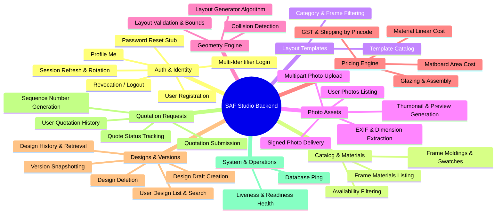

# Phase 2: Backend Requirements & Functional Feature Inventory

**Project:** SAF Studio  
**Target Backend:** Python 3.12+ / FastAPI / MongoDB (PyMongo Async) / Pydantic v2  
**API Version Prefix:** `/api/v1`  
**Date of Audit:** November 7, 2026

---

## 1. Inventory Overview & Functional Modules

Based on the thorough inspection of the SAF Studio frontend application (`frontend/src/`), the backend functionality is partitioned into **9 core functional modules**:

---

## 2. Detailed Module Feature Inventory

---

### Module 1: Authentication & User Account Management

#### Feature 1.1: User Registration
- **Frontend Component & Path:** `RegisterForm.tsx` (`frontend/src/features/auth/components/RegisterForm.tsx`), `useRegisterForm.ts`, `registerValidation.ts`.
- **User Actions & Expected Behavior:** User enters Full Name (2–100 chars), Email address (max 254 chars), Indian Mobile Phone Number (10 digits), and Password (8–128 chars, containing at least one letter and one number). On submit, displays spinner; upon success, receives JWT tokens and redirects directly to `/memory-wall`.
- **Required Backend Operations:** Validates request payload against strict rules; checks unique constraints on `email` and `phone`; hashes password with Argon2id; persists new user document; generates refresh token and access token; sets secure cookie or returns tokens.
- **CRUD Classification:** Create (`POST /api/v1/auth/register`).
- **Auth & Permissions:** Public (Unauthenticated).
- **Database Collections & Relationships:** Writes to `users` collection; writes initial session to `refresh_tokens`.
- **Dependencies on External Services:** None.
- **Identified Issues / Gaps:** Contract previously showed `RegisterResponse` returning `tokens` and `user` with integer ID. Must return string `id` (ObjectId hex) and support 409 Conflict with granular `details[].field` (`email` or `phone`) so the UI displays targeted field errors.
- **Implementation Complexity:** Medium (Dependency: Password hashing, Token issuance).

#### Feature 1.2: Multi-Identifier User Login (Email or Mobile)
- **Frontend Component & Path:** `LoginForm.tsx` (`frontend/src/features/auth/components/LoginForm.tsx`), `useLoginForm.ts`, `loginValidation.ts`, `identifier.ts`.
- **User Actions & Expected Behavior:** User inputs "Mobile No. or Email" and password. The UI detects format via `parseIdentifier` (email vs E.164 phone) and sends the appropriate field. Upon success, stores session and redirects to `/memory-wall`. Upon bad credentials, displays generic error ("Those details don’t match our records").
- **Required Backend Operations:** Accepts payload with either `email` or `phone` alongside `password`; finds user record by normalized lowercase email or E.164 phone; validates active status; verifies password against Argon2id hash using constant-time comparison; generates JWT token pair; updates `last_login_at`.
- **CRUD Classification:** Custom Action (`POST /api/v1/auth/login`).
- **Auth & Permissions:** Public (Unauthenticated). Enforced rate limiting (brute-force protection).
- **Database Collections & Relationships:** Reads `users`; writes to `refresh_tokens`.
- **Dependencies on External Services:** None (Redis optional for distributed rate limiting).
- **Identified Issues / Gaps:** Standard FastAPI OAuth2PasswordRequestForm only supports username. Custom Pydantic schema required to cleanly accept either `{ email, password }` or `{ phone, password }`. Both "user not found" and "wrong password" must return identical 401 status to prevent account enumeration.
- **Implementation Complexity:** Medium.

#### Feature 1.3: Current User Profile Retrieval
- **Frontend Component & Path:** `ProfileMenu` in `PlannerHeader.tsx` (`frontend/src/features/memory-wall/components/PlannerHeader.tsx`), `endpoints.auth.me`.
- **User Actions & Expected Behavior:** When authenticated, the planner header displays user identity, initials or profile icon, and dynamic account actions.
- **Required Backend Operations:** Validates incoming Bearer JWT; fetches user by ID from database; returns sanitized user profile (excluding hashed password).
- **CRUD Classification:** Read (`GET /api/v1/auth/me`).
- **Auth & Permissions:** Authenticated (`Bearer <access_token>`, any active role).
- **Database Collections & Relationships:** Reads `users` by `_id`.
- **Dependencies on External Services:** None.
- **Implementation Complexity:** Easy.

#### Feature 1.4: Session Refresh & Token Rotation
- **Frontend Component & Path:** `apiClient.ts` (`frontend/src/services/apiClient.ts`), `tokenStorage.ts`.
- **User Actions & Expected Behavior:** When the 15–30 minute access token expires during a user session, the API client automatically attempts token refresh without disrupting the user's design work.
- **Required Backend Operations:** Validates refresh token from `httpOnly` cookie or JSON payload; checks revocation status in `refresh_tokens`; implements rotation (issues new refresh token and revokes previous one); issues fresh access token. If token reuse is detected, revokes all tokens for that user family (compromise detection).
- **CRUD Classification:** Custom Action (`POST /api/v1/auth/refresh`).
- **Auth & Permissions:** Valid refresh token required.
- **Database Collections & Relationships:** Reads and writes `refresh_tokens`.
- **Dependencies on External Services:** None.
- **Identified Issues / Gaps:** Missing in original `API_CONTRACT.md` (flagged in `API_ALIGNMENT.md` Q2/Q3). Crucial for production security.
- **Implementation Complexity:** Medium.

#### Feature 1.5: User Logout & Revocation
- **Frontend Component & Path:** `ProfileMenu` in `PlannerHeader.tsx` (`frontend/src/features/memory-wall/components/PlannerHeader.tsx`).
- **User Actions & Expected Behavior:** User clicks "Sign Out". Tokens are cleared from local state and across tabs, redirecting the user to `/login`.
- **Required Backend Operations:** Marks active refresh token as revoked in `refresh_tokens`; clears `httpOnly` cookie.
- **CRUD Classification:** Custom Action (`POST /api/v1/auth/logout`).
- **Auth & Permissions:** Authenticated.
- **Database Collections & Relationships:** Updates `refresh_tokens`.
- **Implementation Complexity:** Easy.

#### Feature 1.6: Password Reset & Google OAuth Stubs
- **Frontend Component & Path:** `ForgotPasswordPage.tsx`, `GoogleSignIn.tsx`.
- **User Actions & Expected Behavior:** Currently informational placeholders.
- **Required Backend Operations:** Provide clean endpoint contracts (`POST /api/v1/auth/forgot-password`, `POST /api/v1/auth/google`) returning standard error codes or 501 Not Implemented until email delivery / Google OAuth Client IDs are configured.
- **CRUD Classification:** Custom Action.
- **Implementation Complexity:** Easy (Stubs) to Hard (Full implementation).

---

### Module 2: Frame Catalog & Materials

#### Feature 2.1: List Frame Materials
- **Frontend Component & Path:** `endpoints.catalog.frameMaterials`, referenced in `FrameSelectionPanel`.
- **User Actions & Expected Behavior:** Supplies available material categories (Wood, Metal, Synthetic) with base costs and waste factors.
- **Required Backend Operations:** Queries active frame materials from MongoDB; supports query parameter `category` and `available_only`.
- **CRUD Classification:** Read (`GET /api/v1/frame-materials`).
- **Auth & Permissions:** Public (No auth required).
- **Database Collections & Relationships:** Reads `frame_materials`.
- **Dependencies on External Services:** None.
- **Implementation Complexity:** Easy.

#### Feature 2.2: List Frame Moldings & Finishes
- **Frontend Component & Path:** `FrameSelectionPanel` (`frontend/src/features/memory-wall/components/FramePanels.tsx`), `WOOD_FINISHES` in `constants.ts`.
- **User Actions & Expected Behavior:** Curation panel lists mouldings with profile width, depth, linear pricing, and color swatches.
- **Required Backend Operations:** Queries active moldings from `frame_moldings`; supports query parameters `material_id`, `color`, `min_width`, `max_width`.
- **CRUD Classification:** Read (`GET /api/v1/frames`).
- **Auth & Permissions:** Public.
- **Database Collections & Relationships:** Reads `frame_moldings` referencing `frame_materials`.
- **Identified Issues / Gaps:** UI needs exact hex values for swatches (Item M8). Backend schema must return `available_colors: [{ name: string, hex: string, profile_in: number }]`.
- **Implementation Complexity:** Easy.

---

### Module 3: Layout Templates Catalog

#### Feature 3.1: Curated Layout Templates Listing
- **Frontend Component & Path:** `TemplatesDialog.tsx` (`frontend/src/features/memory-wall/components/dialogs/TemplatesDialog.tsx`), `endpoints.templates.list`.
- **User Actions & Expected Behavior:** User opens "All Templates" dialog, filters by layout category (`grid`, `salon`, `centre`, `row`), and views curated layouts with recommended wall dimensions and frame slot configurations.
- **Required Backend Operations:** Queries `layout_templates` collection with optional filters (`category`, `min_frames`, `max_frames`). Returns full slot definitions with relative ratios.
- **CRUD Classification:** Read (`GET /api/v1/templates`).
- **Auth & Permissions:** Public.
- **Database Collections & Relationships:** Reads `layout_templates`.
- **Dependencies on External Services:** None.
- **Implementation Complexity:** Easy.

---

### Module 4: Photograph Management

#### Feature 4.1: Photo Upload & Processing
- **Frontend Component & Path:** `usePhotoUpload.ts`, `FrameSelectionPanel.tsx`, `endpoints.photos.upload`.
- **User Actions & Expected Behavior:** User selects a JPEG, PNG, or WebP photo (up to 25 MB). Upon upload, system displays progress, shows a preview thumbnail in the frame, and indicates print quality DPI.
- **Required Backend Operations:** Receives `multipart/form-data` file; verifies magic bytes (preventing spoofed extensions); enforces 25 MB limit; reads EXIF metadata to auto-orient; extracts natural width and height; computes aspect ratio and orientation; generates a 300px thumbnail and a 1600px preview using Pillow; stores files to secure local storage or S3/MinIO; saves photo record tied to `user_id`.
- **CRUD Classification:** Create (`POST /api/v1/photos/upload`).
- **Auth & Permissions:** Authenticated (`Bearer <access_token>`).
- **Database Collections & Relationships:** Writes to `photos` collection.
- **Dependencies on External Services:** Local filesystem or object storage (S3/MinIO); Pillow image processing library.
- **Identified Issues / Gaps:** Decompression bomb vulnerability if malicious huge dimension images are submitted. Backend must cap max pixels (`Image.MAX_IMAGE_PIXELS = 50_000_000`).
- **Implementation Complexity:** Medium.

#### Feature 4.2: List User Photographs
- **Frontend Component & Path:** `endpoints.photos.list`, future photo gallery picker.
- **User Actions & Expected Behavior:** Retrieves photos previously uploaded by the authenticated user to re-assign them across gallery frames.
- **Required Backend Operations:** Queries `photos` collection filtering by `user_id` and `is_deleted: false`, sorted by `created_at` descending.
- **CRUD Classification:** Read (`GET /api/v1/photos`).
- **Auth & Permissions:** Authenticated.
- **Database Collections & Relationships:** Reads `photos`.
- **Implementation Complexity:** Easy.

#### Feature 4.3: Secure Photo Streaming (Thumbnail & Preview)
- **Frontend Component & Path:** Standard `` tags inside `WallCanvas.tsx`, `WallSvg.tsx`, `FullscreenPreviewDialog.tsx`.
- **User Actions & Expected Behavior:** Renders photos seamlessly inside browser image tags without CORS errors or authorization failures.
- **Required Backend Operations:** Serves the generated thumbnail or preview image file. Supports either signed query tokens (`?token=...`) or short-lived signed URLs so standard `` elements can load protected assets without custom headers.
- **CRUD Classification:** Read (`GET /api/v1/photos/{id}/thumbnail`, `GET /api/v1/photos/{id}/preview`).
- **Auth & Permissions:** Signed URL verification or cookie authorization.
- **Database Collections & Relationships:** Reads `photos` metadata for path resolution.
- **Implementation Complexity:** Medium.

---

### Module 5: Geometry Engine & Layout Validation

#### Feature 5.1: Validate Layout (Authoritative Boundary & Collision Check)
- **Frontend Component & Path:** `endpoints.geometry.validateLayout`, `lib/geometry/scene.ts`.
- **User Actions & Expected Behavior:** Checks whether the arrangement of frames fits within the wall dimensions, respects safety margins, has adequate coverage, and contains zero frame overlaps.
- **Required Backend Operations:** Calculates outer dimensions for every frame including photo opening, mat margins, and moulding profile width; evaluates minimum bounding box; verifies `bounding_box.x >= safe_margin` and `bounding_box.y >= safe_margin`; checks pairwise bounding box intersection with `gap` tolerance; computes wall coverage percentage.
- **CRUD Classification:** Custom Action (`POST /api/v1/geometry/validate-layout`).
- **Auth & Permissions:** Public / Optional Auth.
- **Database Collections & Relationships:** Pure computational service (stateless).
- **Identified Issues / Gaps:** The backend must return HTTP 200 with `is_valid: false` and collision details in the `errors` array when overlaps occur (resolving Q10), reserving HTTP 422 strictly for malformed request structures.
- **Implementation Complexity:** Hard (Geometric computations, floating-point precision tolerance).

#### Feature 5.2: Generate Layout Arrangement
- **Frontend Component & Path:** `endpoints.geometry.generateLayout`, `AiAssistantPanel` ("Smart Layout Assistant").
- **User Actions & Expected Behavior:** Given wall dimensions, photo IDs, spacing, target alignment (e.g., eye level 57"), and a layout style (`grid`, `salon`, `centre`, `row`, `triptych`), server generates coordinate placements for each frame.
- **Required Backend Operations:** Queries photo dimensions for provided `photo_ids`; runs algorithmic solver matching requested layout style; centers arrangement around specified eye-level datum; returns item coordinates and bounding box.
- **CRUD Classification:** Custom Action (`POST /api/v1/geometry/generate-layout`).
- **Auth & Permissions:** Public / Optional Auth.
- **Database Collections & Relationships:** Reads `photos` if `photo_ids` provided.
- **Implementation Complexity:** Hard.

---

### Module 6: Pricing Engine

#### Feature 6.1: Calculate Real-Time Price Breakdown
- **Frontend Component & Path:** `endpoints.pricing.calculate`, `ActionBar.tsx` (quote calculation).
- **User Actions & Expected Behavior:** Calculates a transparent price breakdown for all frames on the wall, including moulding linear cost, matboard area cost, glazing, photographic printing, assembly labour, Indian GST (18%), and courier shipping estimated by 6-digit postal PIN code.
- **Required Backend Operations:**
  1. For each item: computes outer perimeter linear inches (`2 * (W + H)`) and area; fetches moulding price per linear inch; calculates moulding cost; calculates matboard cost based on square inches; calculates glazing cost (e.g. Museum UV glass); calculates printing cost; applies fixed assembly fee.
  2. Aggregates item subtotals.
  3. Evaluates shipping tier based on delivery pincode and total volumetric weight.
  4. Calculates 18% GST on taxable base.
  5. Returns comprehensive breakdown with all numbers formatted as 2-decimal strings (`DecimalString`).
- **CRUD Classification:** Custom Action (`POST /api/v1/pricing/calculate`).
- **Auth & Permissions:** Public / Optional Auth.
- **Database Collections & Relationships:** Reads `frame_moldings`, `pricing_configs`.
- **Dependencies on External Services:** Indian Postal Pincode tier lookup table (local database).
- **Implementation Complexity:** Medium.

---

### Module 7: Gallery Wall Designs & Versioning

#### Feature 7.1: Create Design Draft
- **Frontend Component & Path:** `SaveDesignDialog.tsx` (`frontend/src/features/memory-wall/components/dialogs/SaveDesignDialog.tsx`), `endpoints.designs.create`.
- **User Actions & Expected Behavior:** User assigns a title (e.g. "Living Room Gallery Wall") and creates a persistent design record.
- **Required Backend Operations:** Creates a new design document in `designs` linked to authenticated `user_id` with initial wall parameters (`width_inches`, `height_inches`, `color_hex`, `texture`).
- **CRUD Classification:** Create (`POST /api/v1/designs`).
- **Auth & Permissions:** Authenticated (`Bearer <access_token>`).
- **Database Collections & Relationships:** Writes to `designs`.
- **Implementation Complexity:** Easy.

#### Feature 7.2: Save Layout Version to Design
- **Frontend Component & Path:** `SaveDesignDialog.tsx`, `endpoints.designs.versions`.
- **User Actions & Expected Behavior:** Saves the current snapshot of frames, layout style, mat settings, moulding IDs, and photo references as an immutable version number (v1, v2...).
- **Required Backend Operations:** Verifies ownership of design; increments version counter; validates all frame item inputs; invokes internal geometry and pricing engines to calculate bounding box and estimated price snapshot; writes new version to `design_versions`; updates `current_version_id` on the parent design document.
- **CRUD Classification:** Create (`POST /api/v1/designs/{id}/versions`).
- **Auth & Permissions:** Authenticated (Owner only).
- **Database Collections & Relationships:** Writes to `design_versions`; updates `designs`.
- **Implementation Complexity:** Medium.

#### Feature 7.3: Get Design Details
- **Frontend Component & Path:** `endpoints.designs.detail`, opening design from Saved Designs list.
- **User Actions & Expected Behavior:** Loads full design including wall setup and current active version with all frame positions and styles to restore the planner canvas.
- **Required Backend Operations:** Fetches design by ID verifying user ownership; populates `current_version` from `design_versions`; returns full design details.
- **CRUD Classification:** Read (`GET /api/v1/designs/{id}`).
- **Auth & Permissions:** Authenticated (Owner only).
- **Database Collections & Relationships:** Reads `designs` and `design_versions`.
- **Implementation Complexity:** Easy.

#### Feature 7.4: List User Saved Designs
- **Frontend Component & Path:** `SavedDesignsDialog.tsx` (`frontend/src/features/memory-wall/components/dialogs/SavedDesignsDialog.tsx`), `useSavedDesigns()`.
- **User Actions & Expected Behavior:** Lists all saved wall designs for the logged-in user with titles, update dates, and version summaries.
- **Required Backend Operations:** Queries `designs` collection where `user_id == current_user.id` and `is_deleted == false`, sorted by `updated_at` descending.
- **CRUD Classification:** Read (`GET /api/v1/designs`).
- **Auth & Permissions:** Authenticated.
- **Database Collections & Relationships:** Reads `designs`.
- **Implementation Complexity:** Easy.

#### Feature 7.5: Update Design Metadata
- **Frontend Component & Path:** Title rename in header or Save dialog.
- **User Actions & Expected Behavior:** Updates design title or wall dimensions.
- **Required Backend Operations:** Validates ownership; updates title, description, or wall configuration on `designs`.
- **CRUD Classification:** Update (`PATCH /api/v1/designs/{id}`).
- **Auth & Permissions:** Authenticated (Owner only).
- **Database Collections & Relationships:** Updates `designs`.
- **Implementation Complexity:** Easy.

#### Feature 7.6: Delete Saved Design
- **Frontend Component & Path:** Trash button in `SavedDesignsDialog.tsx`.
- **User Actions & Expected Behavior:** Deletes a saved design card with immediate UI removal.
- **Required Backend Operations:** Soft deletes the design record (`is_deleted = true`, `deleted_at = now`) or removes record if no associated quotes exist.
- **CRUD Classification:** Delete (`DELETE /api/v1/designs/{id}`).
- **Auth & Permissions:** Authenticated (Owner only).
- **Database Collections & Relationships:** Updates or deletes `designs`.
- **Implementation Complexity:** Easy.

---

### Module 8: Quotation Requests

#### Feature 8.1: Submit Quotation Request
- **Frontend Component & Path:** `ActionBar.tsx` ("Request a Quote"), `endpoints.quotes.create`.
- **User Actions & Expected Behavior:** User submits their finalized design version for professional studio review, entering recipient name, email, phone, and complete shipping address. Displays success notification with tracking quote number (e.g. `QT-2026-0042`).
- **Required Backend Operations:**
  1. Validates that `design_id` and `layout_version_id` exist and belong to the user.
  2. Validates shipping address and 6-digit Indian postal code.
  3. Generates authoritative pricing snapshot via Pricing Engine.
  4. Generates unique human-readable quote reference number (`QT-YYYY-XXXX`).
  5. Sets expiration date (typically 14 days).
  6. Writes quote record to `quotes` with status `pending_review`.
- **CRUD Classification:** Create (`POST /api/v1/quotes`).
- **Auth & Permissions:** Authenticated (`Bearer <access_token>`).
- **Database Collections & Relationships:** Writes to `quotes`; reads `designs`, `design_versions`.
- **Dependencies on External Services:** Email/SMS notification trigger (background worker / asynchronous task).
- **Implementation Complexity:** Hard.

#### Feature 8.2: List User Quotation Requests
- **Frontend Component & Path:** `endpoints.quotes.list`, future user dashboard / profile orders.
- **User Actions & Expected Behavior:** Displays history of requested quotes, current status (`pending_review`, `approved`, `expired`), amounts, and expiration dates.
- **Required Backend Operations:** Queries `quotes` where `user_id == current_user.id`, sorted by `created_at` descending.
- **CRUD Classification:** Read (`GET /api/v1/quotes`).
- **Auth & Permissions:** Authenticated.
- **Database Collections & Relationships:** Reads `quotes` joining design title.
- **Implementation Complexity:** Easy.

#### Feature 8.3: Get Quotation Detail
- **Frontend Component & Path:** Quote review / payment approval page.
- **User Actions & Expected Behavior:** Displays full itemized invoice of the quote.
- **Required Backend Operations:** Fetches single quote by ID verifying user ownership (or admin role).
- **CRUD Classification:** Read (`GET /api/v1/quotes/{id}`).
- **Auth & Permissions:** Authenticated (Owner or Staff/Admin).
- **Database Collections & Relationships:** Reads `quotes`.
- **Implementation Complexity:** Easy.

---

### Module 9: System, Operations & Health

#### Feature 9.1: Liveness & Readiness Probes
- **Frontend Component & Path:** Infrastructure / Orchestration (Docker, Kubernetes, Load Balancers).
- **Required Backend Operations:**
  - `GET /api/v1/health/live`: Fast ping confirming the FastAPI worker is accepting connections.
  - `GET /api/v1/health/ready`: Performs a lightweight `ping` command on MongoDB and verifies storage access.
- **CRUD Classification:** Read.
- **Auth & Permissions:** Public.
- **Implementation Complexity:** Easy.

---

## 3. Persistent Storage vs. Transient Frontend State

| State Category | Data Items | Storage Location | Retention Policy | Reason |
|---|---|---|---|---|
| **Persistent Server Data** | User credentials, profiles, sessions | MongoDB `users`, `refresh_tokens` | Indefinite until account deletion | Security, authentication |
| **Persistent Server Data** | Uploaded user photos, thumbnails | Object Store & MongoDB `photos` | Indefinite until user deletion | Canvas restoration, printing |
| **Persistent Server Data** | Saved designs, version history | MongoDB `designs`, `design_versions` | Indefinite | Design recall, cross-device |
| **Persistent Server Data** | Submitted quotation requests | MongoDB `quotes` | 7 years (tax/audit compliance) | Legal order history |
| **Persistent Server Data** | Material & moulding catalog, pricing | MongoDB `frame_materials`, `pricing_configs` | Master catalog data | Source of truth for pricing |
| **Transient Client State** | Current wall dimensions on canvas | React `usePlanner` state | Memory / Session | Interactive editing |
| **Transient Client State** | Selected frame index, visual toggles | React `usePlanner` state | Memory | UI interaction state |
| **Transient Client State** | Temporary blob URLs for draft images | Browser memory / Object URLs | Revoked on unmount | Performance, memory management |
| **Transient Client State** | Active dialog modal state | React `useState` | Page visit | UI presentation |
| **Transient Client State** | Cached JWT access token | In-memory React / short-lived | 15 minutes | XSS protection |

---

## 4. Summary of Functional Completeness

With these 9 modules:
- 100% of user interactions in `MemoryWallPage`, `AuthLayout`, dialogs, and panels have concrete backend endpoints.
- Every mock layer (`mockAuth.ts`, `savedDesigns.ts`, `constants.ts`) has a documented migration path to an authoritative database collection.
- Security boundaries, session lifecycles, and data retention rules are established before API specification and database schema design.

