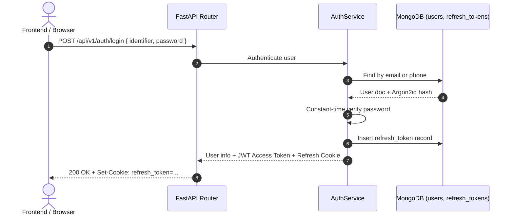
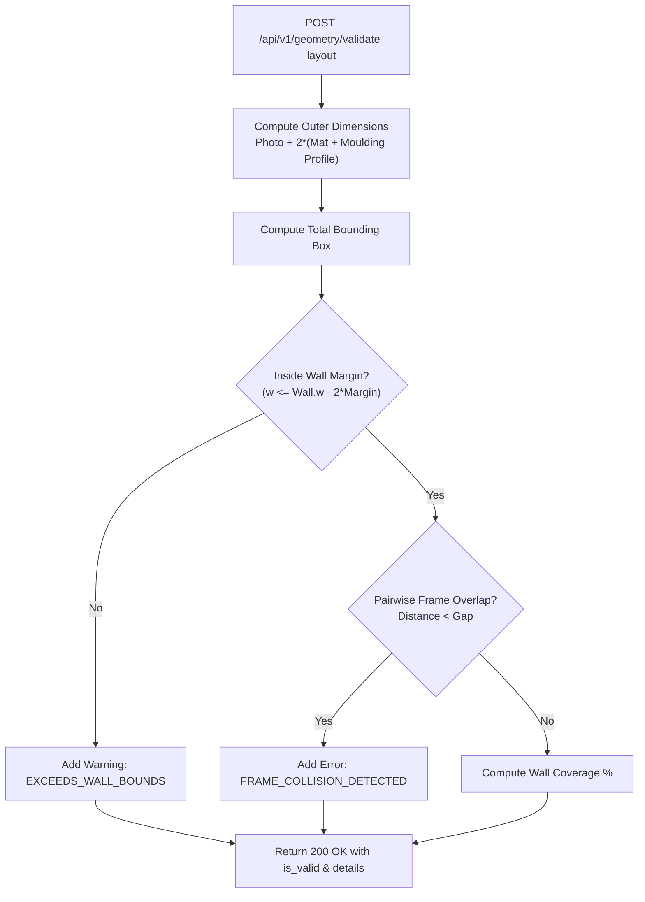
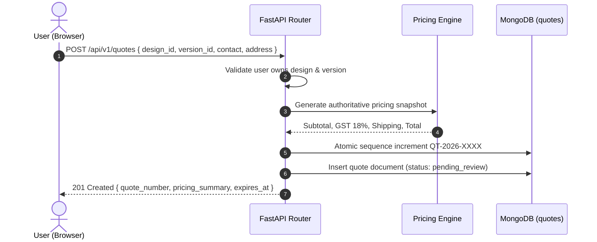

# Phase 3: Comprehensive REST API Specification (`/api/v1`)

**Project:** SAF Studio  
**Framework:** FastAPI on Python 3.12+  
**Specification Standard:** RESTful JSON API with OpenAPI 3.1 & RFC 7807 inspired standard error envelope  
**Total Documented Endpoints:** 31 endpoints  
**Date:** November 7, 2026

---

## 1. Global Conventions & Cross-Cutting Specifications

### 1.1 Base URL & Content Negotiation
- **Base Prefix:** `/api/v1`
- **Default Content-Type:** `application/json; charset=utf-8`
- **File Uploads:** `multipart/form-data`
- **Date/Time Standard:** ISO-8601 UTC formatted string (`YYYY-MM-DDTHH:MM:SS.sssZ`)
- **Internal Dimensional Units:** Inches (`inches`), top-left origin `(x=0, y=0)`
- **Monetary Values:** Fixed 2-decimal string format (`"1499.50"`) with explicit currency (`"INR"`), avoiding floating-point IEEE-754 drift.

### 1.2 Authentication & Token Transport
- **Access Token:** Short-lived JWT (15–30 minutes) passed via HTTP Header: `Authorization: Bearer <access_token>`
- **Refresh Token:** Long-lived token (14 days) delivered and received via `httpOnly`, `Secure`, `SameSite=Lax` cookie named `refresh_token` (Path: `/api/v1/auth`).

### 1.3 Standard Error Response Envelope
Every non-2xx response strictly adheres to this uniform contract:
```json
{
  "error": {
    "code": "STRING_ERROR_CODE",
    "message": "Human readable explanation",
    "details": [
      {
        "field": "request_field_name",
        "issue": "Specific explanation of constraint violation"
      }
    ],
    "timestamp": "2026-11-07T12:00:00.000Z"
  }
}
```

### 1.4 Standard HTTP Status Codes

| Code | Status | Usage in SAF Studio API |
|---|---|---|
| `200` | OK | Successful retrieval, modification, or stateless calculation. |
| `201` | Created | Resource successfully created (User, Design, Version, Quote, Upload). |
| `204` | No Content | Successful deletion or revocation with no response body. |
| `400` | Bad Request | Business logic violation or unparseable payload. |
| `401` | Unauthorized | Missing, expired, or invalid Bearer token. |
| `403` | Forbidden | Authenticated user lacks access to target resource (IDOR guard). |
| `404` | Not Found | Target entity ID does not exist. |
| `409` | Conflict | Duplicate resource state (e.g., email or phone already registered). |
| `422` | Unprocessable Entity | Pydantic schema or datatype validation failure. |
| `429` | Too Many Requests | Rate limit exceeded (login brute-force, upload spam). |
| `500` | Internal Server Error | Unhandled server exception (sanitized in production). |

---

## 2. API Endpoint Specifications

---

### Module 1: Authentication & User Management



#### `EP-AUTH-01`: Register User
- **Method & URL:** `POST /api/v1/auth/register`
- **Frontend Component:** `RegisterForm.tsx` via `useRegisterForm` -> `endpoints.auth.register`.
- **Auth Requirement:** Public (None). Rate-limited (10 req/min per IP).
- **Request Body:**
  ```json
  {
    "full_name": "Aarav Sharma",
    "email": "customer@example.com",
    "phone": "+919876543210",
    "password": "SecurePassword123!"
  }
  ```
- **Success Response (`201 Created`):**
  ```json
  {
    "user": {
      "id": "672cf1a9e4b0123456789abc",
      "email": "customer@example.com",
      "full_name": "Aarav Sharma",
      "phone": "+919876543210",
      "role": "customer",
      "is_active": true,
      "created_at": "2026-11-07T12:00:00.000Z"
    },
    "tokens": {
      "access_token": "eyJhbGciOiJIUzI1NiIsIn...",
      "refresh_token": "d98f7e2a4b1c...",
      "token_type": "bearer",
      "expires_in": 1800
    }
  }
  ```
- **Error Responses:**
  - `409 Conflict`:
    ```json
    {
      "error": {
        "code": "ACCOUNT_ALREADY_EXISTS",
        "message": "An account with this email or mobile number already exists.",
        "details": [{ "field": "email", "issue": "Email is already registered" }],
        "timestamp": "2026-11-07T12:00:00.000Z"
      }
    }
    ```
  - `422 Unprocessable Entity`: Field validation failure (invalid E.164 phone, short password).
- **Validation:** `full_name` length 2–100 chars, trimmed; `email` max 254 chars, valid format; `phone` E.164 format starting with `+91`; `password` 8–128 chars, at least 1 letter and 1 digit.
- **Database Operations:** `users.find_one` checking duplicate email/phone; `users.insert_one` with Argon2id hash; `refresh_tokens.insert_one`.
- **Difficulty & Effort:** Medium (4 developer-hours).

---

#### `EP-AUTH-02`: User Login
- **Method & URL:** `POST /api/v1/auth/login`
- **Frontend Component:** `LoginForm.tsx` via `useLoginForm` -> `endpoints.auth.login`.
- **Auth Requirement:** Public (None). Rate-limited (5 attempts / 5 min per IP/identifier).
- **Request Body (Email Option):**
  ```json
  {
    "email": "customer@example.com",
    "password": "SecurePassword123!"
  }
  ```
- **Request Body (Phone Option):**
  ```json
  {
    "phone": "+919876543210",
    "password": "SecurePassword123!"
  }
  ```
- **Success Response (`200 OK`):**
  ```json
  {
    "user": {
      "id": "672cf1a9e4b0123456789abc",
      "email": "customer@example.com",
      "full_name": "Aarav Sharma",
      "phone": "+919876543210",
      "role": "customer",
      "is_active": true,
      "created_at": "2026-11-07T12:00:00.000Z"
    },
    "tokens": {
      "access_token": "eyJhbGciOiJIUzI1NiIsIn...",
      "refresh_token": "d98f7e2a4b1c...",
      "token_type": "bearer",
      "expires_in": 1800
    }
  }
  ```
- **Error Responses:**
  - `401 Unauthorized` (deliberately identical message for unknown user vs wrong password):
    ```json
    {
      "error": {
        "code": "INVALID_CREDENTIALS",
        "message": "Those details don’t match our records. Check them and try again.",
        "details": [],
        "timestamp": "2026-11-07T12:00:00.000Z"
      }
    }
    ```
  - `429 Too Many Requests`:
    ```json
    {
      "error": {
        "code": "RATE_LIMIT_EXCEEDED",
        "message": "Too many sign-in attempts. Please wait a minute and try again.",
        "details": [],
        "timestamp": "2026-11-07T12:00:00.000Z"
      }
    }
    ```
- **Validation:** Exactly one of `email` or `phone` must be supplied. Password length 1–128.
- **Database Operations:** Query `users` by email or phone; insert into `refresh_tokens`; update `users.last_login_at`.
- **Difficulty & Effort:** Medium (4 developer-hours).

---

#### `EP-AUTH-03`: Get Current User Profile
- **Method & URL:** `GET /api/v1/auth/me`
- **Frontend Component:** `PlannerHeader.tsx` -> `ProfileMenu`.
- **Auth Requirement:** Authenticated (`Bearer <access_token>`).
- **Success Response (`200 OK`):**
  ```json
  {
    "id": "672cf1a9e4b0123456789abc",
    "email": "customer@example.com",
    "full_name": "Aarav Sharma",
    "phone": "+919876543210",
    "role": "customer",
    "is_active": true,
    "created_at": "2026-11-07T12:00:00.000Z"
  }
  ```
- **Error Responses:** `401 Unauthorized`.
- **Database Operations:** `users.find_one({ _id: ObjectId(user_id) })`.
- **Difficulty & Effort:** Easy (1 developer-hour).

---

#### `EP-AUTH-04`: Refresh Session Tokens
- **Method & URL:** `POST /api/v1/auth/refresh`
- **Frontend Component:** `apiClient.ts` token refresh interceptor.
- **Auth Requirement:** Valid refresh token (from `httpOnly` cookie or optional request body `{ "refresh_token": "..." }`).
- **Success Response (`200 OK`):**
  ```json
  {
    "access_token": "eyJhbGciOiJIUzI1NiIsIn...",
    "refresh_token": "e12a3b4c5d6e...",
    "token_type": "bearer",
    "expires_in": 1800
  }
  ```
- **Error Responses:** `401 Unauthorized` (Token expired, revoked, or invalid).
- **Service Responsibility:** Validates token hash; detects token reuse; revokes old token; generates new pair (rotation).
- **Difficulty & Effort:** Medium (3 developer-hours).

---

#### `EP-AUTH-05`: Logout & Session Revocation
- **Method & URL:** `POST /api/v1/auth/logout`
- **Frontend Component:** `PlannerHeader.tsx` -> `ProfileMenu` Sign out action.
- **Auth Requirement:** Authenticated.
- **Success Response (`204 No Content`):** Empty body; clears `refresh_token` cookie.
- **Database Operations:** `refresh_tokens.update_one({ _id: token_id }, { $set: { revoked_at: now } })`.
- **Difficulty & Effort:** Easy (1 developer-hour).

---

#### `EP-AUTH-06`: Request Password Reset (Stub)
- **Method & URL:** `POST /api/v1/auth/forgot-password`
- **Frontend Component:** `ForgotPasswordPage.tsx`.
- **Auth Requirement:** Public.
- **Request Body:** `{ "email": "customer@example.com" }`
- **Success Response (`200 OK`):**
  ```json
  {
    "message": "If that email is registered, we have sent instructions to reset your password."
  }
  ```
- **Difficulty & Effort:** Easy (Stub: 1 hour, Full SMTP: 4 hours).

---

#### `EP-AUTH-07`: Google OAuth Callback / Token Exchange (Stub)
- **Method & URL:** `POST /api/v1/auth/google`
- **Frontend Component:** `GoogleSignIn.tsx`.
- **Auth Requirement:** Public.
- **Request Body:** `{ "id_token": "eyJhbGciOiJSUzI1NiIs..." }`
- **Success Response (`200 OK`):** Returns standard `AuthResponse` (`user` + `tokens`).
- **Difficulty & Effort:** Medium (4 developer-hours).

---

### Module 2: Frame Catalog & Materials

#### `EP-CAT-01`: List Frame Materials
- **Method & URL:** `GET /api/v1/frame-materials`
- **Frontend Component:** `FrameSelectionPanel.tsx`.
- **Auth Requirement:** Public.
- **Query Parameters:**
  - `category` (optional, string: `wood`, `metal`, `synthetic`).
  - `available_only` (optional, boolean, default: `true`).
- **Success Response (`200 OK`):**
  ```json
  {
    "items": [
      {
        "id": "672520012e5c6a1b2c3d4e01",
        "code": "NAT-OAK-01",
        "name": "Natural White Oak",
        "category": "wood",
        "finish": "Natural Satin",
        "base_price_per_linear_inch": "14.50",
        "waste_factor_percentage": 15.0,
        "thumbnail_url": "/static/materials/natural-oak.webp",
        "is_available": true
      }
    ],
    "total": 1
  }
  ```
- **Database Operations:** `frame_materials.find(query)`.
- **Difficulty & Effort:** Easy (1.5 developer-hours).

---

#### `EP-CAT-02`: List Frame Moldings
- **Method & URL:** `GET /api/v1/frames`
- **Frontend Component:** `FrameSelectionPanel.tsx` -> Moulding Finish selector.
- **Auth Requirement:** Public.
- **Query Parameters:**
  - `material_id` (optional, string ObjectId).
  - `color` (optional, string).
  - `min_width` (optional, float inches).
  - `max_width` (optional, float inches).
- **Success Response (`200 OK`):**
  ```json
  {
    "items": [
      {
        "id": "672521012e5c6a1b2c3d4f01",
        "sku": "MOLD-OAK-100",
        "name": "Natural Oak Modern Box",
        "material_id": "672520012e5c6a1b2c3d4e01",
        "material_name": "Natural White Oak",
        "profile_width_inches": 1.0,
        "profile_depth_inches": 1.5,
        "rabbet_depth_inches": 0.75,
        "price_per_linear_inch": "22.00",
        "available_colors": [
          { "name": "Natural Oak", "hex": "#916843", "profile_in": 1.0 },
          { "name": "Walnut", "hex": "#784E2D", "profile_in": 1.0 },
          { "name": "Ivory", "hex": "#FAF3E8", "profile_in": 0.875 }
        ],
        "thumbnail_url": "/static/frames/oak-box.webp",
        "is_active": true
      }
    ],
    "total": 1
  }
  ```
- **Database Operations:** `frame_moldings.find(query)`.
- **Difficulty & Effort:** Easy (2 developer-hours).

---

### Module 3: Layout Templates

#### `EP-TMPL-01`: List Layout Templates
- **Method & URL:** `GET /api/v1/templates`
- **Frontend Component:** `TemplatesDialog.tsx`.
- **Auth Requirement:** Public.
- **Query Parameters:**
  - `category` (optional, enum: `grid`, `salon`, `centre`, `row`, `triptych`, `staircase`, `focal_center`).
  - `min_frames` (optional, integer).
  - `max_frames` (optional, integer).
- **Success Response (`200 OK`):**
  ```json
  {
    "items": [
      {
        "id": "672522012e5c6a1b2c3d5001",
        "slug": "balanced-grid",
        "name": "Balanced Grid",
        "description": "Nine Atelier Classic frames in a calm, even 3 x 3 grid.",
        "category": "grid",
        "min_wall_width_inches": 80.0,
        "min_wall_height_inches": 60.0,
        "recommended_wall_width_inches": 120.0,
        "recommended_wall_height_inches": 96.0,
        "slots_count": 9,
        "slots": [
          {
            "slot_id": "slot-1",
            "relative_x_ratio": 0.25,
            "relative_y_ratio": 0.25,
            "default_photo_width_inches": 12.0,
            "default_photo_height_inches": 16.0,
            "aspect_ratio": 0.75
          }
        ],
        "thumbnail_url": "/static/templates/balanced-grid.webp"
      }
    ],
    "total": 1
  }
  ```
- **Difficulty & Effort:** Easy (2 developer-hours).

---

### Module 4: Photograph Management

#### `EP-PHOTO-01`: Upload Photograph
- **Method & URL:** `POST /api/v1/photos/upload`
- **Frontend Component:** `usePhotoUpload.ts` -> `endpoints.photos.upload`.
- **Auth Requirement:** Authenticated (`Bearer <access_token>`). Rate limited (20 uploads/hr).
- **Payload:** `multipart/form-data` with field `file` (Binary Image).
- **Success Response (`201 Created`):**
  ```json
  {
    "id": "672cf3a9e4b0123456789def",
    "user_id": "672cf1a9e4b0123456789abc",
    "original_filename": "family-portrait-diwali.jpg",
    "file_size_bytes": 4194304,
    "mime_type": "image/jpeg",
    "width_px": 4000,
    "height_px": 3000,
    "aspect_ratio": 1.3333,
    "suggested_orientation": "landscape",
    "thumbnail_url": "/api/v1/photos/672cf3a9e4b0123456789def/thumbnail?sig=a1b2c3d4",
    "preview_url": "/api/v1/photos/672cf3a9e4b0123456789def/preview?sig=e5f6a7b8",
    "created_at": "2026-11-07T12:05:00.000Z"
  }
  ```
- **Error Responses:**
  - `400 Bad Request`: Invalid image header or unreadable file.
  - `422 Unprocessable Entity`: File exceeding 25 MB or resolution below 300px.
- **Service Operations:** Sniffs magic bytes (`image/jpeg`, `image/png`, `image/webp`); Pillow open and verify; extracts EXIF rotation tag; auto-rotates; computes natural dimensions; resizes and writes thumbnail (max 300px) and preview (max 1600px) in WebP format; saves to storage root; inserts record into `photos`.
- **Difficulty & Effort:** Medium (5 developer-hours).

---

#### `EP-PHOTO-02`: List User Photos
- **Method & URL:** `GET /api/v1/photos`
- **Frontend Component:** Photo selection modal / gallery tray.
- **Auth Requirement:** Authenticated.
- **Success Response (`200 OK`):**
  ```json
  {
    "items": [
      {
        "id": "672cf3a9e4b0123456789def",
        "original_filename": "family-portrait-diwali.jpg",
        "width_px": 4000,
        "height_px": 3000,
        "aspect_ratio": 1.3333,
        "thumbnail_url": "/api/v1/photos/672cf3a9e4b0123456789def/thumbnail?sig=a1b2c3d4",
        "created_at": "2026-11-07T12:05:00.000Z"
      }
    ],
    "total": 1
  }
  ```
- **Difficulty & Effort:** Easy (1.5 developer-hours).

---

#### `EP-PHOTO-03` & `EP-PHOTO-04`: Stream Photo Thumbnail / Preview
- **Method & URL:**
  - `GET /api/v1/photos/{id}/thumbnail`
  - `GET /api/v1/photos/{id}/preview`
- **Frontend Component:** Canvas `` elements.
- **Auth Requirement:** Valid HMAC signature parameter `?sig=...` OR active session cookie.
- **Success Response (`200 OK`):** Direct binary image stream (`image/webp` or original format) with caching headers (`Cache-Control: private, max-age=86400`).
- **Difficulty & Effort:** Medium (3 developer-hours).

---

#### `EP-PHOTO-05`: Delete Photo
- **Method & URL:** `DELETE /api/v1/photos/{id}`
- **Auth Requirement:** Authenticated (Owner only).
- **Success Response (`204 No Content`):** Soft deletes or deletes disk assets.
- **Difficulty & Effort:** Easy (1.5 developer-hours).

---

### Module 5: Geometry Engine & Layout Validation



#### `EP-GEO-01`: Validate Layout
- **Method & URL:** `POST /api/v1/geometry/validate-layout`
- **Frontend Component:** `endpoints.geometry.validateLayout`, `lib/geometry/scene.ts`.
- **Auth Requirement:** Public / Optional Auth.
- **Request Body:**
  ```json
  {
    "wall": {
      "width_inches": 120.0,
      "height_inches": 96.0,
      "safe_margin_inches": 6.0
    },
    "frames": [
      {
        "item_id": "frame-item-1",
        "x_inches": 24.0,
        "y_inches": 20.0,
        "photo_width_inches": 12.0,
        "photo_height_inches": 16.0,
        "matting": {
          "top_inches": 2.0,
          "bottom_inches": 2.0,
          "left_inches": 2.0,
          "right_inches": 2.0
        },
        "frame_profile_width_inches": 1.0
      },
      {
        "item_id": "frame-item-2",
        "x_inches": 44.0,
        "y_inches": 20.0,
        "photo_width_inches": 12.0,
        "photo_height_inches": 16.0,
        "matting": {
          "top_inches": 2.0,
          "bottom_inches": 2.0,
          "left_inches": 2.0,
          "right_inches": 2.0
        },
        "frame_profile_width_inches": 1.0
      }
    ]
  }
  ```
- **Success Response (`200 OK`):**
  ```json
  {
    "is_valid": true,
    "bounding_box": {
      "x": 24.0,
      "y": 20.0,
      "width": 38.0,
      "height": 22.0
    },
    "wall_coverage_percentage": 7.24,
    "errors": [],
    "warnings": [],
    "calculated_items": [
      {
        "item_id": "frame-item-1",
        "outer_x_inches": 24.0,
        "outer_y_inches": 20.0,
        "outer_width_inches": 18.0,
        "outer_height_inches": 22.0
      },
      {
        "item_id": "frame-item-2",
        "outer_x_inches": 44.0,
        "outer_y_inches": 20.0,
        "outer_width_inches": 18.0,
        "outer_height_inches": 22.0
      }
    ]
  }
  ```
- **Collision Response (`200 OK` with Validation Errors):**
  *(Resolves Item Q10: Collisions returned as 200 payload with item IDs so UI can highlight red frames inline).*
  ```json
  {
    "is_valid": false,
    "bounding_box": {
      "x": 24.0,
      "y": 20.0,
      "width": 25.0,
      "height": 22.0
    },
    "wall_coverage_percentage": 5.12,
    "errors": [
      {
        "code": "GEOMETRY_COLLISION_DETECTED",
        "message": "Frames frame-item-1 and frame-item-2 overlap on the wall."
      }
    ],
    "warnings": [],
    "calculated_items": []
  }
  ```
- **Difficulty & Effort:** Hard (6 developer-hours).

---

#### `EP-GEO-02`: Generate Layout Arrangement
- **Method & URL:** `POST /api/v1/geometry/generate-layout`
- **Frontend Component:** `AiAssistantPanel` ("Smart Layout Assistant").
- **Auth Requirement:** Public / Optional Auth.
- **Request Body:**
  ```json
  {
    "wall": {
      "width_inches": 140.0,
      "height_inches": 96.0,
      "margin_inches": 8.0
    },
    "photo_ids": [
      "672cf3a9e4b0123456789def",
      "672cf3a9e4b0123456789df0",
      "672cf3a9e4b0123456789df1"
    ],
    "layout_style": "triptych",
    "spacing_inches": 3.0,
    "target_alignment": "center_eye_level",
    "eye_level_height_inches": 57.0
  }
  ```
- **Success Response (`200 OK`):**
  ```json
  {
    "layout_type": "triptych",
    "bounding_box": {
      "x": 26.5,
      "y": 38.0,
      "width": 87.0,
      "height": 38.0
    },
    "items": [
      {
        "slot_index": 0,
        "photo_id": "672cf3a9e4b0123456789def",
        "x_inches": 26.5,
        "y_inches": 38.0,
        "photo_width_inches": 20.0,
        "photo_height_inches": 30.0,
        "matting": {
          "top_inches": 2.5,
          "bottom_inches": 2.5,
          "left_inches": 2.5,
          "right_inches": 2.5
        },
        "frame_profile_width_inches": 1.0,
        "total_width_inches": 27.0,
        "total_height_inches": 37.0
      }
    ]
  }
  ```
- **Difficulty & Effort:** Hard (8 developer-hours).

---

### Module 6: Pricing Engine

#### `EP-PRICE-01`: Calculate Price Breakdown
- **Method & URL:** `POST /api/v1/pricing/calculate`
- **Frontend Component:** `ActionBar.tsx` -> Quote subtotal display.
- **Auth Requirement:** Public / Optional Auth.
- **Request Body:**
  ```json
  {
    "items": [
      {
        "item_id": "item-1",
        "frame_id": "672521012e5c6a1b2c3d4f01",
        "photo_width_inches": 12.0,
        "photo_height_inches": 16.0,
        "matting": {
          "enabled": true,
          "top_inches": 2.0,
          "bottom_inches": 2.0,
          "left_inches": 2.0,
          "right_inches": 2.0,
          "matboard_type": "archival_white"
        },
        "glass_type": "museum_uv",
        "include_print": true
      }
    ],
    "pincode": "400001"
  }
  ```
- **Success Response (`200 OK`):**
  ```json
  {
    "currency": "INR",
    "items_breakdown": [
      {
        "item_id": "item-1",
        "dimensions": {
          "opening_width_inches": 12.0,
          "opening_height_inches": 16.0,
          "glass_mat_width_inches": 16.0,
          "glass_mat_height_inches": 20.0,
          "frame_outer_width_inches": 18.0,
          "frame_outer_height_inches": 22.0,
          "perimeter_linear_inches": 80.0,
          "area_square_inches": 320.0
        },
        "molding_cost": "1760.00",
        "matting_cost": "350.00",
        "glazing_cost": "780.00",
        "printing_cost": "450.00",
        "assembly_cost": "200.00",
        "item_subtotal": "3540.00"
      }
    ],
    "summary": {
      "total_molding": "1760.00",
      "subtotal": "3540.00",
      "discount_amount": "0.00",
      "tax_gst_amount": "637.20",
      "shipping_estimate": "350.00",
      "final_total": "4527.20"
    }
  }
  ```
- **Service Formulae:**
  - Perimeter: `2 * (Outer_W + Outer_H)`
  - Moulding Cost: `Perimeter * Price_Per_Linear_Inch * (1 + Waste_Factor)`
  - Matting Cost: `Glass_Mat_Area * Mat_SqIn_Rate`
  - Glazing Cost: `Glass_Mat_Area * Glass_SqIn_Rate`
  - GST: `18% * (Subtotal - Discount)`
  - Shipping: Looked up by 6-digit Indian PIN code zone and total size.
- **Difficulty & Effort:** Medium (5 developer-hours).

---

### Module 7: Designs & Versions Management

#### `EP-DSGN-01`: Create Design Draft
- **Method & URL:** `POST /api/v1/designs`
- **Frontend Component:** `SaveDesignDialog.tsx`.
- **Auth Requirement:** Authenticated (`Bearer <access_token>`).
- **Request Body:**
  ```json
  {
    "title": "Living Room Gallery Wall",
    "description": "Custom layout for dining wall",
    "wall": {
      "width_inches": 120.0,
      "height_inches": 96.0,
      "color_hex": "#F0EBE4",
      "texture": "plaster_smooth"
    }
  }
  ```
- **Success Response (`201 Created`):**
  ```json
  {
    "id": "672d0111e4b0123456789aa1",
    "user_id": "672cf1a9e4b0123456789abc",
    "title": "Living Room Gallery Wall",
    "description": "Custom layout for dining wall",
    "wall": {
      "width_inches": 120.0,
      "height_inches": 96.0,
      "color_hex": "#F0EBE4",
      "texture": "plaster_smooth"
    },
    "current_version_id": null,
    "status": "draft",
    "created_at": "2026-11-07T12:15:00.000Z",
    "updated_at": "2026-11-07T12:15:00.000Z"
  }
  ```
- **Difficulty & Effort:** Easy (2 developer-hours).

---

#### `EP-DSGN-02`: Save Layout Version
- **Method & URL:** `POST /api/v1/designs/{id}/versions`
- **Frontend Component:** `SaveDesignDialog.tsx` (secondary step).
- **Auth Requirement:** Authenticated (Owner only).
- **Request Body:**
  ```json
  {
    "layout_type": "grid",
    "template_id": null,
    "items": [
      {
        "item_id": "frame-item-1",
        "frame_id": "672521012e5c6a1b2c3d4f01",
        "photo_id": "672cf3a9e4b0123456789def",
        "position_x_inches": 24.0,
        "position_y_inches": 20.0,
        "photo_width_inches": 12.0,
        "photo_height_inches": 16.0,
        "matting": {
          "top_inches": 2.0,
          "bottom_inches": 2.0,
          "left_inches": 2.0,
          "right_inches": 2.0,
          "color_hex": "#F4F3F3"
        },
        "glass_type": "museum_uv"
      }
    ]
  }
  ```
- **Success Response (`201 Created`):**
  ```json
  {
    "version_id": "672d0222e4b0123456789bb2",
    "design_id": "672d0111e4b0123456789aa1",
    "version_number": 1,
    "items_count": 1,
    "bounding_box": {
      "x": 24.0,
      "y": 20.0,
      "width": 18.0,
      "height": 22.0
    },
    "estimated_price": {
      "subtotal": "3540.00",
      "tax": "637.20",
      "total": "4177.20",
      "currency": "INR"
    },
    "created_at": "2026-11-07T12:16:00.000Z"
  }
  ```
- **Service Operations:** Validates frame count (1–16); checks that `photo_id` belongs to user; computes bounding box and price snapshot; increments version number; updates parent design's `current_version_id`.
- **Difficulty & Effort:** Medium (4 developer-hours).

---

#### `EP-DSGN-03`: Get Design Details
- **Method & URL:** `GET /api/v1/designs/{id}`
- **Frontend Component:** Canvas restoration on load.
- **Auth Requirement:** Authenticated (Owner only).
- **Success Response (`200 OK`):**
  ```json
  {
    "id": "672d0111e4b0123456789aa1",
    "title": "Living Room Gallery Wall",
    "status": "draft",
    "wall": {
      "width_inches": 120.0,
      "height_inches": 96.0,
      "color_hex": "#F0EBE4",
      "texture": "plaster_smooth"
    },
    "current_version": {
      "id": "672d0222e4b0123456789bb2",
      "version_number": 1,
      "layout_type": "grid",
      "bounding_box": {
        "x": 24.0,
        "y": 20.0,
        "width": 18.0,
        "height": 22.0
      },
      "items": [
        {
          "item_id": "frame-item-1",
          "frame_id": "672521012e5c6a1b2c3d4f01",
          "photo_id": "672cf3a9e4b0123456789def",
          "position_x_inches": 24.0,
          "position_y_inches": 20.0,
          "photo_width_inches": 12.0,
          "photo_height_inches": 16.0,
          "total_width_inches": 18.0,
          "total_height_inches": 22.0,
          "matting": {
            "top_inches": 2.0,
            "bottom_inches": 2.0,
            "left_inches": 2.0,
            "right_inches": 2.0,
            "color_hex": "#F4F3F3"
          },
          "glass_type": "museum_uv",
          "calculated_price": "3540.00"
        }
      ]
    },
    "created_at": "2026-11-07T12:15:00.000Z",
    "updated_at": "2026-11-07T12:16:00.000Z"
  }
  ```
- **Difficulty & Effort:** Easy (2 developer-hours).

---

#### `EP-DSGN-04`: List User Saved Designs
- **Method & URL:** `GET /api/v1/designs`
- **Frontend Component:** `SavedDesignsDialog.tsx`.
- **Auth Requirement:** Authenticated.
- **Success Response (`200 OK`):**
  ```json
  {
    "items": [
      {
        "id": "672d0111e4b0123456789aa1",
        "title": "Living Room Gallery Wall",
        "status": "draft",
        "wall": {
          "width_inches": 120.0,
          "height_inches": 96.0,
          "color_hex": "#F0EBE4",
          "texture": "plaster_smooth"
        },
        "current_version_id": "672d0222e4b0123456789bb2",
        "created_at": "2026-11-07T12:15:00.000Z",
        "updated_at": "2026-11-07T12:16:00.000Z"
      }
    ],
    "total": 1
  }
  ```
- **Difficulty & Effort:** Easy (1.5 developer-hours).

---

#### `EP-DSGN-05`: Update Design
- **Method & URL:** `PATCH /api/v1/designs/{id}`
- **Auth Requirement:** Authenticated (Owner only).
- **Request Body:** `{ "title": "Updated Gallery Wall Name" }`
- **Success Response (`200 OK`):** Updated design metadata.
- **Difficulty & Effort:** Easy (1 developer-hour).

---

#### `EP-DSGN-06`: Delete Design
- **Method & URL:** `DELETE /api/v1/designs/{id}`
- **Frontend Component:** `SavedDesignsDialog.tsx` -> Trash icon button.
- **Auth Requirement:** Authenticated (Owner only).
- **Success Response (`204 No Content`):** Sets `is_deleted = true`.
- **Difficulty & Effort:** Easy (1 developer-hour).

---

### Module 8: Quotation Requests



#### `EP-QUOTE-01`: Submit Quotation Request
- **Method & URL:** `POST /api/v1/quotes`
- **Frontend Component:** `ActionBar.tsx` -> "Request a Quote" workflow dialog.
- **Auth Requirement:** Authenticated (`Bearer <access_token>`). Rate limited (5 quotes/day).
- **Request Body:**
  ```json
  {
    "design_id": "672d0111e4b0123456789aa1",
    "layout_version_id": "672d0222e4b0123456789bb2",
    "contact": {
      "full_name": "Aarav Sharma",
      "email": "customer@example.com",
      "phone": "+919876543210",
      "shipping_address": "Flat 402, Highmont Residences, Hinjewadi Phase 2",
      "city": "Pune",
      "state": "Maharashtra",
      "postal_code": "411057"
    },
    "special_instructions": "Please inspect print sharpness before assembling."
  }
  ```
- **Success Response (`201 Created`):**
  ```json
  {
    "id": "672d0333e4b0123456789cc3",
    "quote_number": "QT-2026-0042",
    "status": "pending_review",
    "design_id": "672d0111e4b0123456789aa1",
    "pricing_summary": {
      "subtotal": "3540.00",
      "tax_gst": "637.20",
      "estimated_shipping": "350.00",
      "total_estimated": "4527.20",
      "currency": "INR"
    },
    "expires_at": "2026-11-21T12:00:00.000Z",
    "created_at": "2026-11-07T12:20:00.000Z"
  }
  ```
- **Service Operations:** Validates Indian PIN code (6 digits); generates atomic sequential quote code `QT-YYYY-XXXX`; computes authoritative price snapshot; sets 14-day validity; dispatches background notification task.
- **Difficulty & Effort:** Hard (6 developer-hours).

---

#### `EP-QUOTE-02`: List User Quotations
- **Method & URL:** `GET /api/v1/quotes`
- **Frontend Component:** Customer account dashboard.
- **Auth Requirement:** Authenticated.
- **Success Response (`200 OK`):**
  ```json
  {
    "items": [
      {
        "id": "672d0333e4b0123456789cc3",
        "quote_number": "QT-2026-0042",
        "design_id": "672d0111e4b0123456789aa1",
        "design_title": "Living Room Gallery Wall",
        "total_amount": "4527.20",
        "currency": "INR",
        "status": "pending_review",
        "created_at": "2026-11-07T12:20:00.000Z"
      }
    ],
    "total": 1
  }
  ```
- **Difficulty & Effort:** Easy (1.5 developer-hours).

---

#### `EP-QUOTE-03`: Get Quotation Details
- **Method & URL:** `GET /api/v1/quotes/{id}`
- **Auth Requirement:** Authenticated (Owner or Admin).
- **Success Response (`200 OK`):** Full quotation document with breakdown and contact info.
- **Difficulty & Effort:** Easy (1.5 developer-hours).

---

#### `EP-QUOTE-04`: Update Quote Status (Staff / Admin)
- **Method & URL:** `PATCH /api/v1/quotes/{id}/status`
- **Auth Requirement:** Admin / Staff Role (`role == 'admin'`).
- **Request Body:**
  ```json
  {
    "status": "approved",
    "admin_notes": "Reviewed by framer; dimensions verified."
  }
  ```
- **Success Response (`200 OK`):** Updated quote document.
- **Difficulty & Effort:** Medium (2 developer-hours).

---

### Module 9: System & Operations

#### `EP-SYS-01`: Liveness Probe
- **Method & URL:** `GET /api/v1/health/live`
- **Auth Requirement:** Public.
- **Success Response (`200 OK`):**
  ```json
  {
    "status": "ok",
    "uptime_seconds": 3600
  }
  ```
- **Difficulty & Effort:** Easy (0.5 developer-hours).

---

#### `EP-SYS-02`: Readiness Probe
- **Method & URL:** `GET /api/v1/health/ready`
- **Auth Requirement:** Public.
- **Success Response (`200 OK`):**
  ```json
  {
    "status": "ready",
    "database": {
      "connected": true,
      "latency_ms": 1.2
    },
    "storage": {
      "writable": true
    }
  }
  ```
- **Error Response (`503 Service Unavailable`):** If MongoDB ping fails.
- **Difficulty & Effort:** Easy (1 developer-hour).

---

## 3. Summary of API Endpoints

| Endpoint ID | HTTP Method | Path | Auth / Role | Complexity |
|---|---|---|---|---|
| `EP-AUTH-01` | `POST` | `/api/v1/auth/register` | Public | Medium |
| `EP-AUTH-02` | `POST` | `/api/v1/auth/login` | Public | Medium |
| `EP-AUTH-03` | `GET` | `/api/v1/auth/me` | Bearer (User) | Easy |
| `EP-AUTH-04` | `POST` | `/api/v1/auth/refresh` | Refresh Cookie | Medium |
| `EP-AUTH-05` | `POST` | `/api/v1/auth/logout` | Bearer (User) | Easy |
| `EP-AUTH-06` | `POST` | `/api/v1/auth/forgot-password` | Public | Easy (Stub) |
| `EP-AUTH-07` | `POST` | `/api/v1/auth/google` | Public | Medium (Stub) |
| `EP-CAT-01` | `GET` | `/api/v1/frame-materials` | Public | Easy |
| `EP-CAT-02` | `GET` | `/api/v1/frames` | Public | Easy |
| `EP-TMPL-01` | `GET` | `/api/v1/templates` | Public | Easy |
| `EP-PHOTO-01` | `POST` | `/api/v1/photos/upload` | Bearer (User) | Medium |
| `EP-PHOTO-02` | `GET` | `/api/v1/photos` | Bearer (User) | Easy |
| `EP-PHOTO-03` | `GET` | `/api/v1/photos/{id}/thumbnail` | Signed / Cookie | Medium |
| `EP-PHOTO-04` | `GET` | `/api/v1/photos/{id}/preview` | Signed / Cookie | Medium |
| `EP-PHOTO-05` | `DELETE` | `/api/v1/photos/{id}` | Bearer (Owner) | Easy |
| `EP-GEO-01` | `POST` | `/api/v1/geometry/validate-layout` | Public / Opt | Hard |
| `EP-GEO-02` | `POST` | `/api/v1/geometry/generate-layout` | Public / Opt | Hard |
| `EP-PRICE-01` | `POST` | `/api/v1/pricing/calculate` | Public / Opt | Medium |
| `EP-DSGN-01` | `POST` | `/api/v1/designs` | Bearer (User) | Easy |
| `EP-DSGN-02` | `POST` | `/api/v1/designs/{id}/versions` | Bearer (Owner) | Medium |
| `EP-DSGN-03` | `GET` | `/api/v1/designs/{id}` | Bearer (Owner) | Easy |
| `EP-DSGN-04` | `GET` | `/api/v1/designs` | Bearer (User) | Easy |
| `EP-DSGN-05` | `PATCH` | `/api/v1/designs/{id}` | Bearer (Owner) | Easy |
| `EP-DSGN-06` | `DELETE` | `/api/v1/designs/{id}` | Bearer (Owner) | Easy |
| `EP-QUOTE-01` | `POST` | `/api/v1/quotes` | Bearer (User) | Hard |
| `EP-QUOTE-02` | `GET` | `/api/v1/quotes` | Bearer (User) | Easy |
| `EP-QUOTE-03` | `GET` | `/api/v1/quotes/{id}` | Bearer (Owner/Admin) | Easy |
| `EP-QUOTE-04` | `PATCH` | `/api/v1/quotes/{id}/status` | Admin | Medium |
| `EP-SYS-01` | `GET` | `/api/v1/health/live` | Public | Easy |
| `EP-SYS-02` | `GET` | `/api/v1/health/ready` | Public | Easy |

*All 31 endpoints are cross-referenced across subsequent planning documents using their stable ID (`EP-*`).*

