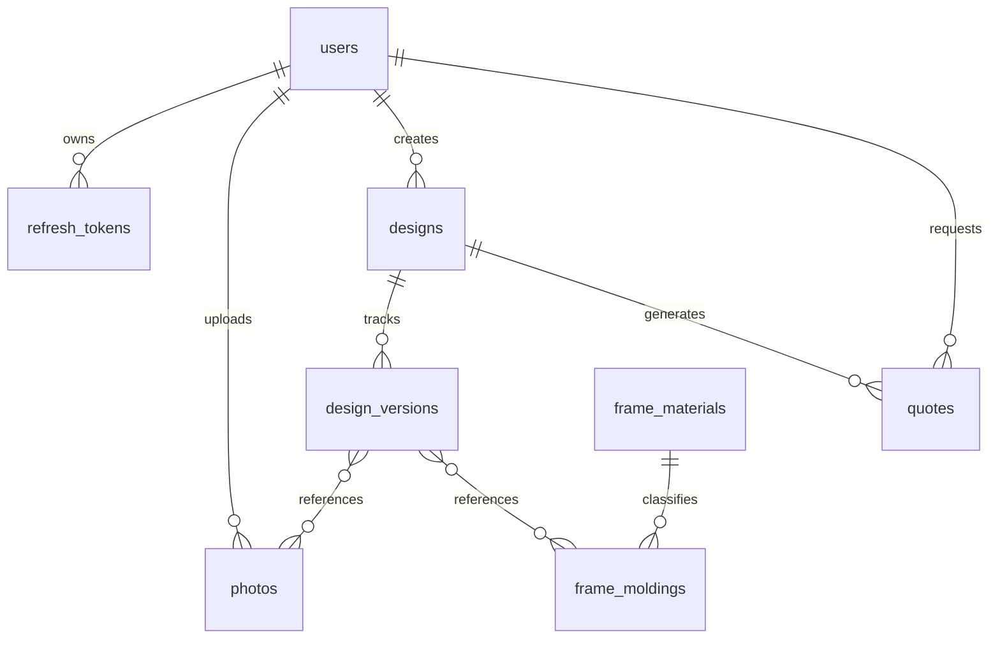

# Phase 4: MongoDB Database Architecture & Schema Design

**Project:** SAF Studio  
**Database Engine:** MongoDB 7.0+ (Document Store)  
**Driver:** Official Asynchronous Driver (`PyMongo Async` / `Motor`)  
**Data Validation Layer:** Pydantic v2 with custom `PyObjectId` serializer  
**Date:** November 7, 2026

---

## 1. Database Architecture & Design Principles

The database design strikes an optimal balance between document embedding (for data read together atomically, such as frame matting and wall specs) and referencing (for independent entities, such as users, photos, and versioned design snapshots).



### Key Engineering Decisions:
1. **ObjectId Serialization:** MongoDB stores `_id` as a 12-byte BSON `ObjectId`. The API layer serializes `_id` to a 24-character hex string named `id`. Incoming string IDs are validated as valid 24-hex characters before conversion to `ObjectId`.
2. **Monetary Representation:** Financial amounts (subtotals, unit prices, tax, shipping, totals) are stored as fixed-precision strings (`"3540.00"`) or integer minor units (paise: `354000`) to eliminate IEEE-754 binary floating-point rounding errors.
3. **Immutability of Versions & Quotes:** `design_versions` and `quotes` capture immutable snapshots of pricing, items, and dimensions so historical orders never change if catalog prices or frame specifications are updated later.
4. **Soft Deletion Strategy:** User designs and photos employ soft deletion (`is_deleted: true`, `deleted_at: ISODateTime`) to preserve quotation lineage and prevent dangling references.

---

## 2. Collection Schemas & Indexing Strategy

---

### Collection 1: `users`
**Purpose:** Stores registered user accounts, authentication credentials, profile data, and roles.

#### Fields & Constraints
| Field | Type | Required | Constraints / Description |
|---|---|---|---|
| `_id` | `ObjectId` | Yes | Primary Key. |
| `email` | `String` | Yes | Lowercase, unique, max 254 chars, RFC 5322. |
| `phone` | `String` | Yes | E.164 format (e.g. `+919876543210`), unique. |
| `password_hash` | `String` | Yes | Argon2id password hash string. |
| `full_name` | `String` | Yes | Trimmed, 2–100 chars, Unicode letters & spaces. |
| `role` | `String` | Yes | Enum: `'customer' \| 'admin' \| 'staff'`. Default: `'customer'`. |
| `is_active` | `Boolean` | Yes | Default: `true`. Deactivated accounts cannot sign in. |
| `last_login_at` | `ISODate` | No | Timestamp of most recent successful authentication. |
| `created_at` | `ISODate` | Yes | UTC creation timestamp. |
| `updated_at` | `ISODate` | Yes | UTC modification timestamp. |

#### Indexes
- `idx_users_email` (Unique): `{ "email": 1 }`
- `idx_users_phone` (Unique): `{ "phone": 1 }`
- `idx_users_role`: `{ "role": 1 }`

#### Example Document
```json
{
  "_id": { "$oid": "672cf1a9e4b0123456789abc" },
  "email": "aarav.sharma@example.com",
  "phone": "+919876543210",
  "password_hash": "$argon2id$v=19$m=65536,t=3,p=4$qW...$abcdef...",
  "full_name": "Aarav Sharma",
  "role": "customer",
  "is_active": true,
  "last_login_at": { "$date": "2026-11-07T12:00:00.000Z" },
  "created_at": { "$date": "2026-11-07T11:45:00.000Z" },
  "updated_at": { "$date": "2026-11-07T12:00:00.000Z" }
}
```

---

### Collection 2: `refresh_tokens`
**Purpose:** Tracks persistent session refresh tokens, rotation chains, and revocation state.

#### Fields & Constraints
| Field | Type | Required | Constraints / Description |
|---|---|---|---|
| `_id` | `ObjectId` | Yes | Primary Key. |
| `user_id` | `ObjectId` | Yes | References `users._id`. |
| `token_hash` | `String` | Yes | SHA-256 hash of the issued refresh token (never plaintext). |
| `family_id` | `String` | Yes | UUID tracking the token rotation chain for reuse detection. |
| `is_revoked` | `Boolean` | Yes | Default: `false`. True if logged out or rotated out. |
| `replaced_by` | `ObjectId` | No | ID of the successor token issued during rotation. |
| `user_agent` | `String` | No | Client device / browser string. |
| `ip_address` | `String` | No | Client IP for anomaly detection. |
| `expires_at` | `ISODate` | Yes | Expiration timestamp (typically `created_at + 14 days`). |
| `created_at` | `ISODate` | Yes | Token issuance timestamp. |

#### Indexes
- `idx_tokens_hash` (Unique): `{ "token_hash": 1 }`
- `idx_tokens_user`: `{ "user_id": 1, "is_revoked": 1 }`
- `idx_tokens_ttl` (TTL Index): `{ "expires_at": 1 }`, `expireAfterSeconds: 0` (Automatic MongoDB document cleanup upon expiry).

#### Example Document
```json
{
  "_id": { "$oid": "672cf211e4b0123456789fff" },
  "user_id": { "$oid": "672cf1a9e4b0123456789abc" },
  "token_hash": "a1b2c3d4e5f60718293a4b5c6d7e8f90...",
  "family_id": "f81d4fae-7dec-11d0-a765-00a0c91e6bf6",
  "is_revoked": false,
  "replaced_by": null,
  "user_agent": "Mozilla/5.0 (Windows NT 10.0; Win64; x64)...",
  "ip_address": "203.0.113.195",
  "expires_at": { "$date": "2026-11-21T12:00:00.000Z" },
  "created_at": { "$date": "2026-11-07T12:00:00.000Z" }
}
```

---

### Collection 3: `frame_materials`
**Purpose:** Master catalog of framing material categories (wood, metal, synthetic).

#### Fields & Constraints
| Field | Type | Required | Constraints / Description |
|---|---|---|---|
| `_id` | `ObjectId` | Yes | Primary Key. |
| `code` | `String` | Yes | Unique SKU/code (e.g. `WOOD-OAK`). |
| `name` | `String` | Yes | Material name (e.g. `Natural White Oak`). |
| `category` | `String` | Yes | Enum: `'wood' \| 'metal' \| 'synthetic'`. |
| `finish` | `String` | Yes | Surface finish (e.g. `Natural Satin`). |
| `base_price_per_linear_inch` | `String` | Yes | Decimal string (e.g. `"14.50"`). |
| `waste_factor_percentage` | `Double` | Yes | Cutting scrap allowance (e.g. `15.0`). |
| `thumbnail_url` | `String` | Yes | Relative or CDN image path. |
| `is_available` | `Boolean` | Yes | Inventory availability flag. |

#### Indexes
- `idx_materials_code` (Unique): `{ "code": 1 }`
- `idx_materials_category`: `{ "category": 1, "is_available": 1 }`

---

### Collection 4: `frame_moldings`
**Purpose:** Specific profiles, moulding face widths, depths, and available color finishes.

#### Fields & Constraints
| Field | Type | Required | Constraints / Description |
|---|---|---|---|
| `_id` | `ObjectId` | Yes | Primary Key. |
| `sku` | `String` | Yes | Unique SKU (e.g. `MOLD-OAK-BOX-100`). |
| `name` | `String` | Yes | Commercial profile name. |
| `material_id` | `ObjectId` | Yes | References `frame_materials._id`. |
| `material_name` | `String` | Yes | Denormalized material name for fast list reads. |
| `profile_width_inches` | `Double` | Yes | Visible face width in inches (adds to outer frame dimensions). |
| `profile_depth_inches` | `Double` | Yes | Depth off wall in inches. |
| `rabbet_depth_inches` | `Double` | Yes | Glass/mat/photo cavity depth. |
| `price_per_linear_inch` | `String` | Yes | Decimal string (e.g. `"22.00"`). |
| `available_colors` | `Array[Object]`| Yes | Array of `{ "name": String, "hex": String, "profile_in": Double }`. |
| `thumbnail_url` | `String` | Yes | Relative or CDN thumbnail. |
| `is_active` | `Boolean` | Yes | Catalog active status. |

#### Indexes
- `idx_moldings_sku` (Unique): `{ "sku": 1 }`
- `idx_moldings_material`: `{ "material_id": 1, "is_active": 1 }`

#### Example Document
```json
{
  "_id": { "$oid": "672521012e5c6a1b2c3d4f01" },
  "sku": "MOLD-OAK-BOX-100",
  "name": "Natural Oak Modern Box",
  "material_id": { "$oid": "672520012e5c6a1b2c3d4e01" },
  "material_name": "Natural White Oak",
  "profile_width_inches": 1.0,
  "profile_depth_inches": 1.5,
  "rabbet_depth_inches": 0.75,
  "price_per_linear_inch": "22.00",
  "available_colors": [
    { "name": "Natural Oak", "hex": "#916843", "profile_in": 1.0 },
    { "name": "Walnut", "hex": "#784E2D", "profile_in": 1.0 },
    { "name": "Ivory", "hex": "#FAF3E8", "profile_in": 0.875 },
    { "name": "Whitewash", "hex": "#EEE6DE", "profile_in": 0.875 },
    { "name": "Dark Teak", "hex": "#774B31", "profile_in": 1.0 },
    { "name": "Honey", "hex": "#B1875F", "profile_in": 1.0 },
    { "name": "Golden Teak", "hex": "#B07840", "profile_in": 1.125 },
    { "name": "Mahogany", "hex": "#7A432D", "profile_in": 1.125 }
  ],
  "thumbnail_url": "/static/frames/oak-box.webp",
  "is_active": true
}
```

---

### Collection 5: `photos`
**Purpose:** Metadata, file storage locations, and dimensions for user-uploaded photographs.

#### Fields & Constraints
| Field | Type | Required | Constraints / Description |
|---|---|---|---|
| `_id` | `ObjectId` | Yes | Primary Key. |
| `user_id` | `ObjectId` | Yes | References `users._id` (Owner). |
| `original_filename` | `String` | Yes | Sanitized client filename. |
| `storage_key` | `String` | Yes | Storage disk path or S3 key. |
| `thumbnail_key` | `String` | Yes | 300px WebP thumbnail path. |
| `preview_key` | `String` | Yes | 1600px WebP preview path. |
| `mime_type` | `String` | Yes | Enum: `'image/jpeg' \| 'image/png' \| 'image/webp'`. |
| `file_size_bytes` | `Int64` | Yes | File size in bytes (max 26,214,400 bytes). |
| `width_px` | `Int32` | Yes | Natural image width in pixels. |
| `height_px` | `Int32` | Yes | Natural image height in pixels. |
| `aspect_ratio` | `Double` | Yes | `width_px / height_px` rounded to 4 decimals. |
| `suggested_orientation` | `String`| Yes | Enum: `'portrait' \| 'landscape' \| 'square'`. |
| `is_deleted` | `Boolean` | Yes | Default: `false`. Soft deletion. |
| `created_at` | `ISODate` | Yes | Upload timestamp. |

#### Indexes
- `idx_photos_user`: `{ "user_id": 1, "is_deleted": 1, "created_at": -1 }`

---

### Collection 6: `layout_templates`
**Purpose:** Pre-engineered gallery wall templates with slot coordinates and dimensions.

#### Fields & Constraints
| Field | Type | Required | Constraints / Description |
|---|---|---|---|
| `_id` | `ObjectId` | Yes | Primary Key. |
| `slug` | `String` | Yes | Unique identifier (e.g. `balanced-grid`). |
| `name` | `String` | Yes | Template title (e.g. `Balanced Grid`). |
| `description` | `String` | Yes | Editorial copy. |
| `category` | `String` | Yes | Enum: `'grid' \| 'salon' \| 'centre' \| 'row' \| 'triptych' \| 'staircase'`. |
| `min_wall_width_inches` | `Double` | Yes | Minimum recommended wall width. |
| `min_wall_height_inches` | `Double` | Yes | Minimum recommended wall height. |
| `recommended_wall_width_inches` | `Double` | Yes | Optimal wall width. |
| `recommended_wall_height_inches` | `Double` | Yes | Optimal wall height. |
| `slots_count` | `Int32` | Yes | Number of frame slots. |
| `slots` | `Array[Object]`| Yes | Array of relative slot definitions (`relative_x_ratio`, etc.). |
| `thumbnail_url` | `String` | Yes | Preview thumbnail asset path. |
| `is_active` | `Boolean` | Yes | Active flag. |

#### Indexes
- `idx_templates_slug` (Unique): `{ "slug": 1 }`
- `idx_templates_category`: `{ "category": 1, "slots_count": 1 }`

---

### Collection 7: `designs`
**Purpose:** Top-level gallery wall project container owned by a user.

#### Fields & Constraints
| Field | Type | Required | Constraints / Description |
|---|---|---|---|
| `_id` | `ObjectId` | Yes | Primary Key. |
| `user_id` | `ObjectId` | Yes | References `users._id` (Owner). |
| `title` | `String` | Yes | Design title (1–80 chars, default: `"My Gallery Wall"`). |
| `description` | `String` | No | Optional user notes (max 500 chars). |
| `wall` | `Object` | Yes | Embedded: `{ width_inches, height_inches, color_hex, texture }`. |
| `current_version_id` | `ObjectId` | No | References latest `design_versions._id`. |
| `status` | `String` | Yes | Enum: `'draft' \| 'saved' \| 'ordered'`. Default: `'draft'`. |
| `is_deleted` | `Boolean` | Yes | Default: `false`. Soft deletion flag. |
| `created_at` | `ISODate` | Yes | UTC creation timestamp. |
| `updated_at` | `ISODate` | Yes | UTC modification timestamp. |

#### Indexes
- `idx_designs_user`: `{ "user_id": 1, "is_deleted": 1, "updated_at": -1 }`

---

### Collection 8: `design_versions`
**Purpose:** Immutable snapshot of frame placements, styling, and pricing calculation for a design.

#### Fields & Constraints
| Field | Type | Required | Constraints / Description |
|---|---|---|---|
| `_id` | `ObjectId` | Yes | Primary Key. |
| `design_id` | `ObjectId` | Yes | References `designs._id`. |
| `version_number` | `Int32` | Yes | Sequential version number (1, 2, 3...). |
| `layout_type` | `String` | Yes | Enum: `'custom' \| 'grid' \| 'salon' \| 'centre' \| 'row' \| 'triptych'`. |
| `template_id` | `ObjectId` | No | Optional reference to `layout_templates._id`. |
| `items` | `Array[Object]`| Yes | Array of 1–16 frame items (see below). |
| `bounding_box` | `Object` | Yes | `{ x, y, width, height }` in inches. |
| `estimated_price` | `Object` | Yes | `{ subtotal, tax, total, currency }` decimal strings. |
| `created_at` | `ISODate` | Yes | Version creation timestamp. |

#### Embedded Frame Item Schema (`items[]`):
```json
{
  "item_id": "frame-item-1",
  "frame_id": { "$oid": "672521012e5c6a1b2c3d4f01" },
  "photo_id": { "$oid": "672cf3a9e4b0123456789def" },
  "position_x_inches": 24.0,
  "position_y_inches": 20.0,
  "photo_width_inches": 12.0,
  "photo_height_inches": 16.0,
  "total_width_inches": 18.0,
  "total_height_inches": 22.0,
  "matting": {
    "top_inches": 2.0,
    "bottom_inches": 2.0,
    "left_inches": 2.0,
    "right_inches": 2.0,
    "color_hex": "#F4F3F3"
  },
  "glass_type": "museum_uv",
  "calculated_price": "3540.00"
}
```

#### Indexes
- `idx_versions_design_ver` (Unique Compound): `{ "design_id": 1, "version_number": 1 }`

---

### Collection 9: `quotes`
**Purpose:** Official customer quotation requests, shipping contact info, and immutable pricing.

#### Fields & Constraints
| Field | Type | Required | Constraints / Description |
|---|---|---|---|
| `_id` | `ObjectId` | Yes | Primary Key. |
| `quote_number` | `String` | Yes | Unique sequential code (e.g. `QT-2026-0042`). |
| `user_id` | `ObjectId` | Yes | References `users._id`. |
| `design_id` | `ObjectId` | Yes | References `designs._id`. |
| `layout_version_id` | `ObjectId` | Yes | References `design_versions._id`. |
| `status` | `String` | Yes | Enum: `'pending_review' \| 'approved' \| 'rejected' \| 'expired' \| 'converted'`. Default: `'pending_review'`. |
| `contact` | `Object` | Yes | Embedded: `{ full_name, email, phone, shipping_address, city, state, postal_code }`. |
| `special_instructions`| `String` | No | Customer notes. |
| `pricing_summary` | `Object` | Yes | Embedded snapshot: `{ subtotal, tax_gst, estimated_shipping, total_estimated, currency }`. |
| `admin_notes` | `String` | No | Internal studio review notes. |
| `expires_at` | `ISODate` | Yes | Quote expiry date (`created_at + 14 days`). |
| `created_at` | `ISODate` | Yes | Submission timestamp. |
| `updated_at` | `ISODate` | Yes | Last status change timestamp. |

#### Indexes
- `idx_quotes_number` (Unique): `{ "quote_number": 1 }`
- `idx_quotes_user`: `{ "user_id": 1, "created_at": -1 }`
- `idx_quotes_status`: `{ "status": 1 }`

---

### Collection 10: `pricing_configs`
**Purpose:** Operational pricing rates, glass costs, matting rates, and shipping tiers.

#### Fields & Constraints
| Field | Type | Required | Description |
|---|---|---|---|
| `_id` | `ObjectId` | Yes | Primary Key. |
| `key` | `String` | Yes | Configuration key (e.g. `DEFAULT_RATES_V1`). |
| `matboard_rates_per_sqin` | `Object` | Yes | Keyed by matboard type (e.g. `{ "archival_white": "0.45" }`). |
| `glass_rates_per_sqin` | `Object` | Yes | Keyed by glass type (e.g. `{ "museum_uv": "1.20" }`). |
| `printing_rates_per_sqin`| `Object` | Yes | Keyed by paper type (e.g. `{ "fine_art_luster": "0.60" }`). |
| `base_assembly_fee` | `String` | Yes | Flat assembly labor fee per frame (e.g. `"200.00"`). |
| `tax_gst_percentage` | `Double` | Yes | Standard 18.0% GST. |
| `shipping_tiers` | `Array` | Yes | Indian postal code zone definitions and flat weight rates. |
| `is_active` | `Boolean` | Yes | Active pricing version flag. |

#### Indexes
- `idx_pricing_active`: `{ "is_active": 1 }`

---

## 3. Transactions & Data Integrity

MongoDB multi-document ACID transactions are utilized for sensitive multi-collection updates:

1. **Quotation Submission Transaction:**
   ```
   START TRANSACTION
   1. Verify design & layout version existence and user ownership.
   2. Atomically increment sequence counter in counters collection: "QT-2026-" + pad_zeros(count, 4).
   3. Write new quote document in quotes collection.
   4. Update designs.status = 'ordered'.
   COMMIT
   ```
2. **Version Snapshotting Transaction:**
   ```
   START TRANSACTION
   1. Query current highest version_number for design_id.
   2. Insert new record in design_versions with version_number + 1.
   3. Update designs.current_version_id = new_version._id.
   COMMIT
   ```

---

## 4. Schema Versioning & Migration Strategy

1. **Version Field:** Every collection includes an optional `_schema_version: 1` field in documents.
2. **Backward-Compatible Additions:** All new fields in Pydantic models specify default values (`Field(default=None)` or `Field(default_factory=...)`).
3. **Migration Scripts:** Dedicated migration utilities in `backend/app/db/migrations/` handle asynchronous bulk updates when breaking structural transformations occur, logging progress to an audit collection.

