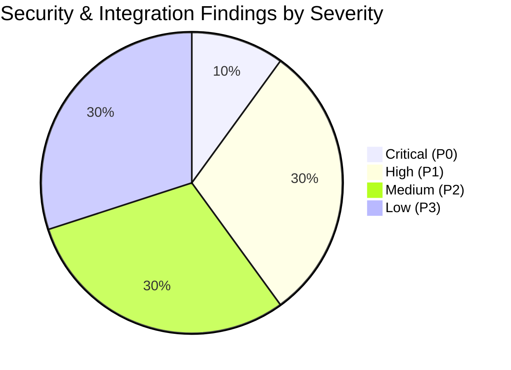

# Phase 5: Security Architecture & Bug Audit

**Project:** SAF Studio  
**Audit Scope:** Frontend Source (`frontend/src/`), Wire Contracts (`API_CONTRACT.md`, `API_ALIGNMENT.md`), and Planned FastAPI Backend  
**Security Standard:** OWASP Top 10 (2021), ASVS Level 2, NIST SP 800-63B  
**Date:** November 7, 2026

---

## 1. Executive Security Assessment

The SAF Studio frontend exhibits strong defensive engineering practices: strict TypeScript typing, zero usage of `dangerouslySetInnerHTML` or `eval`, rigorous CSP header definitions, input length boundaries, and defensive error body sanitization.

However, transitioning from a mock UI to a production-ready full-stack application introduces critical security boundaries that must be explicitly resolved before backend implementation:
1. **Token Storage Vulnerability:** Storage of long-lived refresh tokens in browser `localStorage`.
2. **Asset Authorization Paradox:** Inability of standard HTML `` elements to pass `Authorization: Bearer` headers for private user photos.
3. **Resource Exhaustion & Decompression Bombs:** Risk of memory exhaustion from 25 MB image uploads.
4. **Broken Object-Level Authorization (BOLA/IDOR):** Requirement for strict database-level tenancy filtering across user gallery designs and quotes.

---

## 2. Evidence-Based Vulnerability & Bug Audit

Findings are classified according to severity: **Critical, High, Medium, Low**.



---

### Finding 1: Refresh Token Stored in `localStorage`
- **Classification:** **Critical** (Backend & Frontend Architecture)
- **Affected Files:** `frontend/src/services/tokenStorage.ts`, `docs/API_CONTRACT.md` (§1.1), `API_ALIGNMENT.md` (Q3).
- **Evidence:**
  `frontend/src/services/tokenStorage.ts`:
  ```typescript
  export interface StoredSession {
    tokens: AuthTokens
    cachedUser: User | null
  }
  const STORAGE_KEY = 'saf.auth.tokens.v1'
  // Both access_token and refresh_token are persisted in window.localStorage
  ```
- **Impact:** Any client-side XSS vulnerability (e.g. via compromised third-party npm dependency or browser extension) can read `localStorage` and exfiltrate the persistent refresh token, granting indefinite account takeover.
- **Recommended Fix:**
  1. Split token transport: The backend must issue the `refresh_token` exclusively via an `httpOnly`, `Secure`, `SameSite=Lax` cookie restricted to the `/api/v1/auth` path.
  2. The short-lived `access_token` (15 min) remains in memory (or short-lived storage) and is refreshed silently via `POST /api/v1/auth/refresh`.

---

### Finding 2: Unauthenticated Asset Authorization Paradox (Item Q5)
- **Classification:** **High** (Architectural Integration Blocker)
- **Affected Files:** `frontend/src/types/api/photos.ts:31`, `frontend/src/features/memory-wall/components/WallCanvas.tsx`.
- **Evidence:**
  `types/api/photos.ts`:
  ```typescript
  export interface Photo {
    thumbnail_url: string // e.g. "/photos/123/thumbnail"
    preview_url: string   // e.g. "/photos/123/preview"
  }
  ```
  `WallCanvas.tsx` renders frames using standard HTML `` or SVG `<image href={photo.url} />`. Browsers do not send custom HTTP `Authorization: Bearer <token>` headers when fetching image tags.
- **Impact:** If endpoints require Bearer auth, all canvas photos fail to render. If endpoints are made completely public, user photos are exposed to unauthorized web scraping.
- **Recommended Fix:**
  Implement HMAC-signed time-limited query tokens for photo streaming:
  `GET /api/v1/photos/{id}/preview?sig=<HMAC>&expires=<UNIX_TIMESTAMP>`
  The backend photo upload and list endpoints generate these pre-signed URLs, allowing `` to load protected photos without exposing them publicly.

---

### Finding 3: Memory Exhaustion via Image Decompression Bombs
- **Classification:** **High** (Backend Denial of Service)
- **Affected Files:** Planned `POST /api/v1/photos/upload`, `frontend/src/features/memory-wall/hooks/usePhotoUpload.ts`.
- **Evidence:** The frontend permits uploads up to 25 MB (`MAX_UPLOAD_BYTES = 25 * 1024 * 1024`). A compressed JPEG or PNG file under 25 MB can decompress into hundreds of megapixels (e.g., a "zip bomb" style image), allocating gigabytes of RAM in Python's Pillow library during thumbnail generation.
- **Impact:** Single request can trigger Out-Of-Memory (OOM) kills on the FastAPI worker container, causing denial of service for all users.
- **Recommended Fix:**
  1. Enforce Pillow pixel safety limit before decoding:
     ```python
     from PIL import Image
     Image.MAX_IMAGE_PIXELS = 50_000_000 # 50 Megapixels max
     ```
  2. Validate image dimensions directly from the file header before reading pixel data into memory.
  3. Validate magic bytes using `python-magic` to reject spoofed file types.

---

### Finding 4: Missing Rate Limiting on Authentication & Resource Endpoints
- **Classification:** **High** (Security / Abuse)
- **Affected Files:** Planned `POST /api/v1/auth/login`, `POST /api/v1/auth/register`, `POST /api/v1/pricing/calculate`.
- **Evidence:** `docs/API_CONTRACT.md` contains no rate-limiting headers or 429 status specifications.
- **Impact:** Automated bots can execute credential-stuffing attacks against user accounts, or flood the computationally intensive geometry and pricing engines with complex layouts.
- **Recommended Fix:**
  Implement slowapi / Redis rate limiting:
  - `/api/v1/auth/login`: 5 requests / minute per IP and per identifier.
  - `/api/v1/auth/register`: 3 requests / minute per IP.
  - `/api/v1/photos/upload`: 20 requests / hour per user.
  - Return HTTP 429 Too Many Requests with standard error envelope.

---

### Finding 5: Collision Status Inconsistency (Item Q10)
- **Classification:** **Medium** (Integration Contract Bug)
- **Affected Files:** `frontend/src/types/api/geometry.ts:42`, `docs/API_CONTRACT.md` (§6.1).
- **Evidence:**
  `API_CONTRACT.md` specifies returning `422 Unprocessable Entity` with code `GEOMETRY_COLLISION_DETECTED` when frames overlap. However, the frontend API client treats 422 as an unhandled form exception, throwing an `ApiError` which shows a global error toast rather than allowing the planner canvas to highlight the conflicting frames in red.
- **Impact:** Poor user experience; planner interactions break when users drag frames into temporary overlap during interactive wall curation.
- **Recommended Fix:**
  The backend must return HTTP 200 with `is_valid: false` and the collision details inside the `errors[]` array, reserving HTTP 422 exclusively for malformed JSON or unparseable numbers.

---

### Finding 6: Broken Object-Level Authorization (BOLA / IDOR) Risk
- **Classification:** **Medium** (Access Control)
- **Affected Files:** Planned `GET /api/v1/designs/{id}`, `POST /api/v1/designs/{id}/versions`, `GET /api/v1/quotes/{id}`.
- **Evidence:** RESTful URLs expose resource IDs in the path: `/designs/{id}`. If the service layer retrieves documents using only `{ "_id": ObjectId(id) }` without verifying `{ "user_id": current_user.id }`, an authenticated attacker can guess or enumerate ObjectIds to view and overwrite another user's gallery wall designs.
- **Impact:** Severe data privacy violation and unauthorized design manipulation.
- **Recommended Fix:**
  Every database query on user-owned collections must enforce tenancy in the query predicate:
  ```python
  design = await db.designs.find_one({
      "_id": ObjectId(design_id),
      "user_id": current_user.id,
      "is_deleted": False
  })
  if not design:
      raise NotFoundException("Design not found") # 404 prevents ID enumeration
  ```

---

### Finding 7: Account Enumeration via Differential Auth Errors
- **Classification:** **Medium** (Privacy / Reconnaissance)
- **Affected Files:** Planned `POST /api/v1/auth/login`, `API_ALIGNMENT.md` (Q17).
- **Evidence:** Returning "No account exists with this email" vs "Incorrect password" enables attackers to build lists of registered customer emails and phone numbers.
- **Impact:** Credential stuffing targets and user privacy leak.
- **Recommended Fix:**
  Both failure modes must return identical HTTP 401 Unauthorized status with the exact error message:
  `"Those details don’t match our records. Check them and try again."`

---

### Finding 8: Type Incompatibility: Integer `EntityId` vs MongoDB `ObjectId`
- **Classification:** **Low** (Frontend–Backend Contract Mismatch)
- **Affected Files:** `frontend/src/types/api/common.ts:13`.
- **Evidence:**
  ```typescript
  export type EntityId = number // Contract shows integers in examples
  ```
  MongoDB generates 24-character hexadecimal BSON `ObjectId` strings (e.g. `"672cf1a9e4b0123456789abc"`).
- **Impact:** JavaScript converts numeric IDs. Attempting to parse a 24-character hex string as a number yields `NaN`, breaking all client-side ID comparisons.
- **Recommended Fix:**
  Update `frontend/src/types/api/common.ts` to `export type EntityId = string`. The backend serializes all MongoDB `_id` values to string hex representations in Pydantic response models.

---

### Finding 9: Resource Exhaustion via Unbounded Collections
- **Classification:** **Low** (Performance / Availability)
- **Affected Files:** Planned `GET /api/v1/photos`, `GET /api/v1/designs`, `GET /api/v1/quotes`.
- **Evidence:** Endpoints currently lack `limit` and `offset` / `skip` query parameters.
- **Impact:** A power user with hundreds of uploaded photos or saved designs could trigger massive BSON serialization payloads, degrading response latency.
- **Recommended Fix:**
  Implement default pagination: `limit=20` (max `100`), `skip=0`, returning total count in `ListResponse<T>`.

---

### Finding 10: Timing Attacks on Password & Token Verification
- **Classification:** **Low** (Cryptographic Best Practice)
- **Affected Files:** Planned `auth/service.py`.
- **Evidence:** Comparing string token hashes with standard `==` operator leaks character-by-character timing differences.
- **Impact:** Theoretical token hash reconstruction via precision timing measurements.
- **Recommended Fix:**
  Use Python's `secrets.compare_digest()` for all token and signature comparisons, and Argon2id's built-in constant-time verification for password checks.

---

## 3. Security Architecture Specifications

### 3.1 Password Hashing Specification
- **Algorithm:** Argon2id (Winner of Password Hashing Competition)
- **Parameters:**
  - Memory Cost ($m$): $65536 \text{ KiB}$ (64 MiB)
  - Time Cost ($t$): 3 iterations
  - Parallelism ($p$): 4 threads
- **Fallback:** Bcrypt with minimum work factor 12.

### 3.2 Token Architecture
- **JWT Signing Algorithm:** Asymmetric `RS256` (or symmetric `HS256` with 256-bit high-entropy secret).
- **Claims Included:** `sub` (User ObjectId hex), `role` (`customer`, `admin`), `exp` (15 minutes), `iat`, `jti` (UUID).
- **Revocation:** Managed via `family_id` tracking in `refresh_tokens`. If a revoked token is presented, all active sessions belonging to that token family are immediately purged (compromise response).

### 3.3 NoSQL Injection Safeguards
- All MongoDB queries use native PyMongo asynchronous driver methods with strictly typed dictionary filters.
- Raw JavaScript execution (`$where`, `mapReduce`) is completely disabled and forbidden.
- All request parameters pass through Pydantic v2 validation before reaching repository functions.

### 3.4 CORS Policy
- Allowed Origins in Production: Strictly whitelisted frontend domains (e.g. `https://studio.saf.in`).
- Allowed Methods: `GET, POST, PUT, PATCH, DELETE, OPTIONS`.
- Allowed Headers: `Authorization, Content-Type, Accept, X-Requested-With`.
- Allow Credentials: `true` (enables `httpOnly` refresh cookie exchange).

