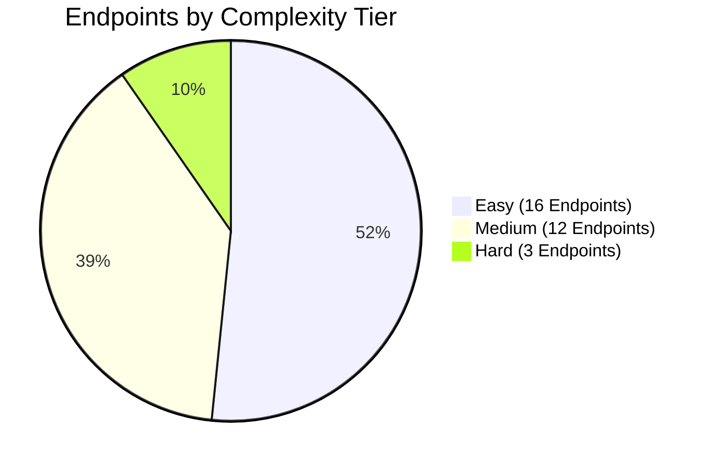

# Phase 7: Backend Complexity, Effort & Priority Assessment

**Project:** SAF Studio Backend  
**Total Documented Endpoints:** 31 endpoints across 9 modules  
**Estimation Units:** Developer-Hours (Coding, Unit/Integration Testing, Frontend Integration/Documentation)  
**Date:** November 7, 2026

---

## 1. Complexity Classification Framework

Every backend endpoint is evaluated according to the four standard engineering tiers:

| Complexity | Criteria & Typical Characteristics |
|---|---|
| **Easy** | Basic CRUD operations, simple schema validation, read-only catalog queries, minimal dependencies, standard MongoDB filters. |
| **Medium** | Authentication workflows, JWT token rotation, cryptographic hashing, file uploads, image transformations, relational joins, complex aggregations. |
| **Hard** | Computational geometry engines, floating-point layout calculations, dynamic pricing algorithms, transactional ordering, sequential ID generation. |
| **Very Hard** | Distributed consensus, massive real-time concurrency, external hardware or payment integrations, advanced AI/ML solvers. *(None in MVP scope).* |

---

## 2. Comprehensive Endpoint Assessment Table

Effort is broken down into:
- **Code:** Endpoint router, service, schema, and repository implementation.
- **Test:** Pytest unit tests, HTTPX integration tests, edge case assertions.
- **Integ:** Frontend integration verification, OpenAPI documentation, and debugging.
- **Total:** Estimated developer-hours.

| Endpoint ID | HTTP Method & Path | Complexity | Code (h) | Test (h) | Integ (h) | Total (h) | Key Technical Challenges & Dependencies | Risk | Phase |
|---|---|---|---|---|---|---|---|---|---|
| `EP-AUTH-01` | `POST /api/v1/auth/register` | Medium | 2.5 | 1.5 | 1.0 | **5.0** | Unique phone/email check, Argon2id hashing, initial session creation. | Med | 2 |
| `EP-AUTH-02` | `POST /api/v1/auth/login` | Medium | 2.5 | 1.5 | 1.0 | **5.0** | Multi-identifier (email or E.164 phone), constant-time verify, brute-force rate limit. | High | 2 |
| `EP-AUTH-03` | `GET /api/v1/auth/me` | Easy | 1.0 | 0.5 | 0.5 | **2.0** | Bearer token validation, database user retrieval. | Low | 2 |
| `EP-AUTH-04` | `POST /api/v1/auth/refresh` | Medium | 2.0 | 1.5 | 0.5 | **4.0** | Token rotation, reuse detection (compromise response), httpOnly cookie. | High | 2 |
| `EP-AUTH-05` | `POST /api/v1/auth/logout` | Easy | 1.0 | 0.5 | 0.5 | **2.0** | Refresh token revocation in database, cookie clearing. | Low | 2 |
| `EP-AUTH-06` | `POST /api/v1/auth/forgot-password`| Easy (Stub) | 1.0 | 0.5 | 0.5 | **2.0** | Generic success response preventing email harvesting. | Low | 2 |
| `EP-AUTH-07` | `POST /api/v1/auth/google` | Medium (Stub)| 2.0 | 1.0 | 1.0 | **4.0** | Google ID token verification (stubbed for initial release). | Med | 2 |
| `EP-CAT-01` | `GET /api/v1/frame-materials` | Easy | 1.0 | 0.5 | 0.5 | **2.0** | Seed data queries, category filtering. | Low | 3 |
| `EP-CAT-02` | `GET /api/v1/frames` | Easy | 1.5 | 0.5 | 0.5 | **2.5** | Multi-attribute filtering (material, color, profile width). | Low | 3 |
| `EP-TMPL-01` | `GET /api/v1/templates` | Easy | 1.5 | 0.5 | 0.5 | **2.5** | Template slot querying, category filtering. | Low | 3 |
| `EP-PHOTO-01` | `POST /api/v1/photos/upload` | Medium | 3.0 | 2.0 | 1.0 | **6.0** | Magic byte validation, EXIF auto-rotation, Pillow thumbnail/preview resize, decompression bomb defense. | High | 4 |
| `EP-PHOTO-02` | `GET /api/v1/photos` | Easy | 1.0 | 0.5 | 0.5 | **2.0** | Scoped user query, sorting by created date. | Low | 4 |
| `EP-PHOTO-03` | `GET /api/v1/photos/{id}/thumbnail`| Medium | 2.0 | 1.0 | 0.5 | **3.5** | HMAC signature verification, binary WebP streaming. | Med | 4 |
| `EP-PHOTO-04` | `GET /api/v1/photos/{id}/preview` | Medium | 2.0 | 1.0 | 0.5 | **3.5** | HMAC signature verification, binary WebP streaming. | Med | 4 |
| `EP-PHOTO-05` | `DELETE /api/v1/photos/{id}` | Easy | 1.0 | 0.5 | 0.5 | **2.0** | Ownership validation, soft deletion, asset cleanup. | Low | 4 |
| `EP-GEO-01` | `POST /api/v1/geometry/validate-layout`| Hard | 4.0 | 2.5 | 1.5 | **8.0** | Outer bounds computation, 2D AABB collision detection, wall coverage percentage. | High | 5 |
| `EP-GEO-02` | `POST /api/v1/geometry/generate-layout`| Hard | 5.0 | 3.0 | 2.0 | **10.0** | Algorithmic solver (grid, salon, centre, row), deterministic seed PRNG, eye-level alignment. | High | 5 |
| `EP-PRICE-01` | `POST /api/v1/pricing/calculate` | Medium | 3.5 | 2.0 | 1.5 | **7.0** | Linear perimeter formulas, matboard area, glazing costs, GST (18%), pincode shipping tiers. | Med | 6 |
| `EP-DSGN-01` | `POST /api/v1/designs` | Easy | 1.5 | 0.5 | 0.5 | **2.5** | User-linked document creation, default wall specs. | Low | 7 |
| `EP-DSGN-02` | `POST /api/v1/designs/{id}/versions` | Medium | 3.0 | 1.5 | 1.0 | **5.5** | Incremental version numbering, transaction, price snapshot, bounding box calculation. | Med | 7 |
| `EP-DSGN-03` | `GET /api/v1/designs/{id}` | Easy | 1.5 | 0.5 | 0.5 | **2.5** | Ownership check, joined current version retrieval. | Low | 7 |
| `EP-DSGN-04` | `GET /api/v1/designs` | Easy | 1.0 | 0.5 | 0.5 | **2.0** | Scoped user design listing, soft-delete filter. | Low | 7 |
| `EP-DSGN-05` | `PATCH /api/v1/designs/{id}` | Easy | 1.0 | 0.5 | 0.5 | **2.0** | Metadata updates, title clamping. | Low | 7 |
| `EP-DSGN-06` | `DELETE /api/v1/designs/{id}` | Easy | 1.0 | 0.5 | 0.5 | **2.0** | Soft deletion (`is_deleted: true`). | Low | 7 |
| `EP-QUOTE-01` | `POST /api/v1/quotes` | Hard | 4.0 | 2.5 | 1.5 | **8.0** | Atomic sequence increment (`QT-2026-XXXX`), transaction, frozen pricing snapshot, contact validation. | High | 8 |
| `EP-QUOTE-02` | `GET /api/v1/quotes` | Easy | 1.0 | 0.5 | 0.5 | **2.0** | User quotes listing, status badges. | Low | 8 |
| `EP-QUOTE-03` | `GET /api/v1/quotes/{id}` | Easy | 1.0 | 0.5 | 0.5 | **2.0** | Itemized quote details, access control. | Low | 8 |
| `EP-QUOTE-04` | `PATCH /api/v1/quotes/{id}/status` | Medium | 1.5 | 1.0 | 0.5 | **3.0** | Role-based permission (Admin only), audit logging. | Med | 8 |
| `EP-SYS-01` | `GET /api/v1/health/live` | Easy | 0.5 | 0.25 | 0.25 | **1.0** | Application uptime ping. | Low | 1 |
| `EP-SYS-02` | `GET /api/v1/health/ready` | Easy | 0.5 | 0.25 | 0.25 | **1.0** | Async MongoDB ping & disk writability check. | Low | 1 |

---

## 3. Categorized Effort Tables

### 3.1 Quick Wins (16 Easy Endpoints)
Straightforward implementations providing immediate functional progress and establishing database conventions:

| Endpoint ID | Endpoint Name | Method & Path | Total Effort | Key Value Delivered |
|---|---|---|---|---|
| `EP-SYS-01` | Liveness Check | `GET /api/v1/health/live` | 1.0 h | Container health monitoring |
| `EP-SYS-02` | Readiness Check | `GET /api/v1/health/ready` | 1.0 h | Database connection verification |
| `EP-AUTH-03` | Current User Profile | `GET /api/v1/auth/me` | 2.0 h | Authenticated user verification |
| `EP-AUTH-05` | User Logout | `POST /api/v1/auth/logout` | 2.0 h | Session clearing |
| `EP-AUTH-06` | Forgot Password Stub | `POST /api/v1/auth/forgot-password`| 2.0 h | UI placeholder fulfillment |
| `EP-CAT-01` | List Materials | `GET /api/v1/frame-materials` | 2.0 h | Material catalog for curation |
| `EP-CAT-02` | List Moldings | `GET /api/v1/frames` | 2.5 h | Moulding finishes & swatches |
| `EP-TMPL-01` | List Templates | `GET /api/v1/templates` | 2.5 h | Curated gallery templates |
| `EP-PHOTO-02` | List User Photos | `GET /api/v1/photos` | 2.0 h | User photo library |
| `EP-PHOTO-05` | Delete Photo | `DELETE /api/v1/photos/{id}` | 2.0 h | Storage management |
| `EP-DSGN-01` | Create Design Draft | `POST /api/v1/designs` | 2.5 h | Wall design project container |
| `EP-DSGN-03` | Get Design Detail | `GET /api/v1/designs/{id}` | 2.5 h | Canvas design restoration |
| `EP-DSGN-04` | List User Designs | `GET /api/v1/designs` | 2.0 h | "My Saved Templates" dialog |
| `EP-DSGN-05` | Update Design | `PATCH /api/v1/designs/{id}` | 2.0 h | Rename design |
| `EP-DSGN-06` | Delete Design | `DELETE /api/v1/designs/{id}` | 2.0 h | Delete saved design |
| `EP-QUOTE-02` | List User Quotes | `GET /api/v1/quotes` | 2.0 h | User quotation dashboard |
| `EP-QUOTE-03` | Get Quote Detail | `GET /api/v1/quotes/{id}` | 2.0 h | Full quotation invoice |
| **Total Quick Wins**| **17 Endpoints** | | **34.0 h** | **Fast foundational coverage** |

---

### 3.2 Moderate Complexity (11 Endpoints)
Endpoints requiring security handling, image binary processing, relational snapshots, or multi-field financial math:

| Endpoint ID | Endpoint Name | Method & Path | Total Effort | Key Technical Challenge |
|---|---|---|---|---|
| `EP-AUTH-01` | User Registration | `POST /api/v1/auth/register` | 5.0 h | Argon2id, unique constraints, token generation |
| `EP-AUTH-02` | Multi-Identifier Login | `POST /api/v1/auth/login` | 5.0 h | Email vs E.164 phone parsing, timing defense |
| `EP-AUTH-04` | Session Refresh & Rotation | `POST /api/v1/auth/refresh` | 4.0 h | Token reuse detection, cookie management |
| `EP-AUTH-07` | Google Auth Stub | `POST /api/v1/auth/google` | 4.0 h | OAuth token verification |
| `EP-PHOTO-01` | Upload Photo | `POST /api/v1/photos/upload` | 6.0 h | Magic bytes, EXIF rotation, Pillow WebP resize |
| `EP-PHOTO-03` | Stream Thumbnail | `GET /api/v1/photos/{id}/thumbnail`| 3.5 h | HMAC signature verification |
| `EP-PHOTO-04` | Stream Preview | `GET /api/v1/photos/{id}/preview` | 3.5 h | HMAC signature verification |
| `EP-PRICE-01` | Calculate Price | `POST /api/v1/pricing/calculate` | 7.0 h | Linear inch, mat area, GST 18%, pincode shipping |
| `EP-DSGN-02` | Save Design Version | `POST /api/v1/designs/{id}/versions`| 5.5 h | Snapshot immutability, price calculation |
| `EP-QUOTE-04` | Update Quote Status | `PATCH /api/v1/quotes/{id}/status` | 3.0 h | Admin RBAC, audit logging |
| **Total Moderate** | **10 Endpoints** | | **46.5 h** | **Core application functionality** |

---

### 3.3 High Complexity (3 Endpoints)
Computationally intensive algorithms, deterministic geometry solvers, and multi-document transactions:

| Endpoint ID | Endpoint Name | Method & Path | Total Effort | Key Technical Challenge |
|---|---|---|---|---|
| `EP-GEO-01` | Validate Layout | `POST /api/v1/geometry/validate-layout` | 8.0 h | Floating-point 2D AABB collision detection |
| `EP-GEO-02` | Generate Layout | `POST /api/v1/geometry/generate-layout` | 10.0 h | Porting 4 deterministic layout algorithms |
| `EP-QUOTE-01` | Submit Quotation | `POST /api/v1/quotes` | 8.0 h | Atomic sequence numbering, multi-document TX |
| **Total High** | **3 Endpoints** | | **26.0 h** | **Mission-critical domain engines** |

---

## 4. Overall Effort Summary

| Effort Category | Developer-Hours (Range) |
|---|---|
| **Core Framework Setup & DB Lifespan (Phase 1)** | 10 – 14 hours |
| **Quick Wins Endpoints (17 Endpoints)** | 30 – 38 hours |
| **Moderate Complexity Endpoints (10 Endpoints)** | 42 – 52 hours |
| **High Complexity Endpoints (3 Endpoints)** | 24 – 30 hours |
| **Security Hardening, Rate Limiting & E2E Validation** | 12 – 16 hours |
| **Total Project Effort Range** | **118 – 150 hours (Approx. 3.0 – 3.5 developer-weeks)** |

