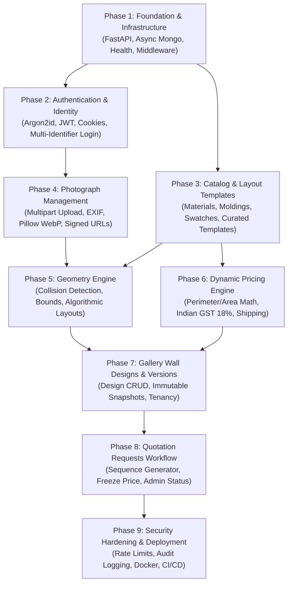

# Phase 8: Dependency-Aware Backend Implementation Roadmap

**Project:** SAF Studio Backend  
**Development Methodology:** Incremental, Dependency-Driven Phased Engineering  
**Total Development Phases:** 9 Phases  
**Date:** November 7, 2026

---

## 1. Roadmap Overview & Dependency Graph

To guarantee that no module is developed in an un-testable vacuum, implementation strictly progresses from low-level infrastructure through core domain models up to high-level transactional workflows.

---

## 2. Phase-by-Phase Execution Plan

---

### Phase 1: Foundation, Database Lifespan & Standard Middleware
- **Objective:** Establish the FastAPI application skeleton, async MongoDB connection pool, environment configuration, custom exception normalization, and health checks.
- **Prerequisites:** Python 3.12+ virtual environment, MongoDB 7.0+ instance running.
- **Endpoints Implemented:**
  - `EP-SYS-01`: `GET /api/v1/health/live`
  - `EP-SYS-02`: `GET /api/v1/health/ready`
- **Database Operations:** Setup MongoDB connection manager via `PyMongo Async` / `Motor`, database ping verification.
- **Architecture & Infrastructure:**
  - `core/config.py` with Pydantic `BaseSettings`.
  - `core/database.py` with startup/shutdown lifecycle.
  - `core/error_handlers.py` enforcing uniform error envelope `{ error: { code, message, details, timestamp } }`.
  - CORS middleware configured for frontend origin.
- **Testing Strategy:** Pytest testing health endpoints and DB connection failure handling.
- **Estimated Effort:** 10 – 12 hours.

---

### Phase 2: Authentication, Security & User Accounts
- **Objective:** Build secure multi-identifier authentication (email or Indian phone), password hashing, JWT token issuance, session refresh rotation, and logout revocation.
- **Prerequisites:** Phase 1 complete.
- **Endpoints Implemented:**
  - `EP-AUTH-01`: `POST /api/v1/auth/register`
  - `EP-AUTH-02`: `POST /api/v1/auth/login`
  - `EP-AUTH-03`: `GET /api/v1/auth/me`
  - `EP-AUTH-04`: `POST /api/v1/auth/refresh`
  - `EP-AUTH-05`: `POST /api/v1/auth/logout`
  - `EP-AUTH-06`: `POST /api/v1/auth/forgot-password` (Stub)
  - `EP-AUTH-07`: `POST /api/v1/auth/google` (Stub)
- **Database Operations:** Collections `users` and `refresh_tokens`. Unique indexes on `email` and `phone`. TTL index on `refresh_tokens.expires_at`.
- **Security Guardrails:** Argon2id password hashing, constant-time compare, token reuse detection (family invalidation), `httpOnly` secure refresh cookie.
- **Testing Strategy:** 100% test coverage on credential verification, duplicate email/phone conflict (409), expired token rejection (401), and token rotation integrity.
- **Estimated Effort:** 18 – 22 hours.

---

### Phase 3: Frame Catalog, Materials & Templates
- **Objective:** Provide the static data catalog for framing materials, moulding profiles, swatches, and curated layout templates.
- **Prerequisites:** Phase 1 complete.
- **Endpoints Implemented:**
  - `EP-CAT-01`: `GET /api/v1/frame-materials`
  - `EP-CAT-02`: `GET /api/v1/frames`
  - `EP-TMPL-01`: `GET /api/v1/templates`
- **Database Operations:** Collections `frame_materials`, `frame_moldings`, `layout_templates`. Database seeder populating standard wood finishes (`walnut`, `oak`, etc.) with hex codes and face widths.
- **Testing Strategy:** Verify query filtering (by category, color, profile width).
- **Estimated Effort:** 6 – 8 hours.

---

### Phase 4: Photograph Management & Image Processing
- **Objective:** Implement user photo upload, EXIF-based auto-rotation, Pillow thumbnail and preview generation, and secure HMAC-signed image streaming for HTML `` compatibility.
- **Prerequisites:** Phase 2 (Authentication) complete.
- **Endpoints Implemented:**
  - `EP-PHOTO-01`: `POST /api/v1/photos/upload`
  - `EP-PHOTO-02`: `GET /api/v1/photos`
  - `EP-PHOTO-03`: `GET /api/v1/photos/{id}/thumbnail`
  - `EP-PHOTO-04`: `GET /api/v1/photos/{id}/preview`
  - `EP-PHOTO-05`: `DELETE /api/v1/photos/{id}`
- **Database Operations:** Collection `photos` with user index.
- **Security & Media Guardrails:** Magic byte verification (`image/jpeg`, `image/png`, `image/webp`), 25 MB file ceiling, Pillow decompression bomb defense (`MAX_IMAGE_PIXELS = 50_000_000`), HMAC URL signing.
- **Testing Strategy:** Mock multipart file uploads, test invalid formats, test oversize images, verify thumbnail generation dimensions and aspect ratios.
- **Estimated Effort:** 14 – 18 hours.

---

### Phase 5: Geometry Engine & Layout Solvers
- **Objective:** Implement authoritative server-side layout boundary calculations, 2D AABB collision detection, and deterministic arrangement generators.
- **Prerequisites:** Phase 1 & 3 complete.
- **Endpoints Implemented:**
  - `EP-GEO-01`: `POST /api/v1/geometry/validate-layout`
  - `EP-GEO-02`: `POST /api/v1/geometry/generate-layout`
- **Architecture Note:** Port the frontend geometry algorithms (`rect.ts`, `layouts.ts`, `random.ts`) into Python (`app/modules/geometry/engine/`) so backend validation uses identical mathematical models.
- **Contract Realignment:** Frame collisions return HTTP 200 with `is_valid: false` and collision errors for inline UI highlighting (resolving Item Q10).
- **Testing Strategy:** Extensive matrix tests across 1,000+ layout permutations verifying boundary invariants, zero overlap, and mathematical determinism.
- **Estimated Effort:** 18 – 22 hours.

---

### Phase 6: Dynamic Pricing Engine
- **Objective:** Implement dynamic framing price computation based on linear moulding inches, matboard area, UV glass, fine art printing, Indian GST (18%), and Indian postal code shipping tiers.
- **Prerequisites:** Phase 3 (Catalog) complete.
- **Endpoints Implemented:**
  - `EP-PRICE-01`: `POST /api/v1/pricing/calculate`
- **Database Operations:** Collection `pricing_configs` storing rate cards per square inch and assembly fees.
- **Data Conventions:** All output currency fields formatted as 2-decimal strings (`DecimalString`).
- **Testing Strategy:** Unit tests with manual calculation fixtures matching known framing configurations to the exact paisa.
- **Estimated Effort:** 8 – 10 hours.

---

### Phase 7: Gallery Wall Designs & Versioning
- **Objective:** Deliver user-scoped gallery wall project persistence, multi-version snapshot history, design updating, and soft deletion.
- **Prerequisites:** Phase 2 (Auth), Phase 4 (Photos), Phase 5 (Geometry), Phase 6 (Pricing) complete.
- **Endpoints Implemented:**
  - `EP-DSGN-01`: `POST /api/v1/designs`
  - `EP-DSGN-02`: `POST /api/v1/designs/{id}/versions`
  - `EP-DSGN-03`: `GET /api/v1/designs/{id}`
  - `EP-DSGN-04`: `GET /api/v1/designs`
  - `EP-DSGN-05`: `PATCH /api/v1/designs/{id}`
  - `EP-DSGN-06`: `DELETE /api/v1/designs/{id}`
- **Database Operations:** Collections `designs` and `design_versions`. Unique compound index on `{ design_id, version_number }`.
- **Security Guardrails:** Strict BOLA/IDOR tenancy enforcement on all CRUD operations (`user_id == current_user.id`).
- **Testing Strategy:** Multi-version creation tests, unauthorized access tests (User B attempting to view User A's design -> 404).
- **Estimated Effort:** 14 – 18 hours.

---

### Phase 8: Quotation Requests Workflow
- **Objective:** Enable customer quotation submissions, atomic sequential quote numbering (`QT-YYYY-XXXX`), frozen price snapshots, customer quotation history, and staff review status updates.
- **Prerequisites:** Phase 7 (Designs & Versions) complete.
- **Endpoints Implemented:**
  - `EP-QUOTE-01`: `POST /api/v1/quotes`
  - `EP-QUOTE-02`: `GET /api/v1/quotes`
  - `EP-QUOTE-03`: `GET /api/v1/quotes/{id}`
  - `EP-QUOTE-04`: `PATCH /api/v1/quotes/{id}/status` (Staff/Admin)
- **Database Operations:** Collection `quotes`. Atomic sequence generator in `counters`.
- **Testing Strategy:** Concurrency tests for sequence number collision prevention, address validation, expired quote handling.
- **Estimated Effort:** 12 – 16 hours.

---

### Phase 9: Security Hardening, Rate Limiting & Production Readiness
- **Objective:** Configure production rate limiting, audit logging, Docker multi-stage build, automated database backup scripts, and CI/CD workflows.
- **Prerequisites:** Phases 1–8 complete.
- **Key Tasks:**
  - Configure `slowapi` rate limiting on `/auth/login` (5/min), `/auth/register` (3/min), and `/photos/upload` (20/hr).
  - Production security headers: HSTS, X-Content-Type-Options, Referrer-Policy.
  - Final OpenAPI contract generation and verification against `frontend/src/types/api/*`.
  - Multi-stage Dockerfile and Docker Compose orchestration.
- **Testing Strategy:** Security regression suite, automated dependency vulnerability check (`pip-audit`), load testing.
- **Estimated Effort:** 12 – 16 hours.

---

## 3. Milestones & Timeline Projection

| Milestone | Scope | Cumulative Effort |
|---|---|---|
| **M1: Core & Identity Ready** | Phases 1 & 2 (Server, Mongo, Full Auth) | ~30 hours |
| **M2: Catalog & Media Ready** | Phases 3 & 4 (Materials, Templates, Photo Upload/Stream) | ~54 hours |
| **M3: Calculation Engines Ready** | Phases 5 & 6 (Geometry Engine, Pricing Engine) | ~82 hours |
| **M4: Designs & Quotes Ready** | Phases 7 & 8 (Design Persistence, Versions, Quotations) | ~112 hours |
| **M5: Production Release Ready** | Phase 9 (Hardening, Verification, Docker, Deployment) | ~128 – 140 hours |

