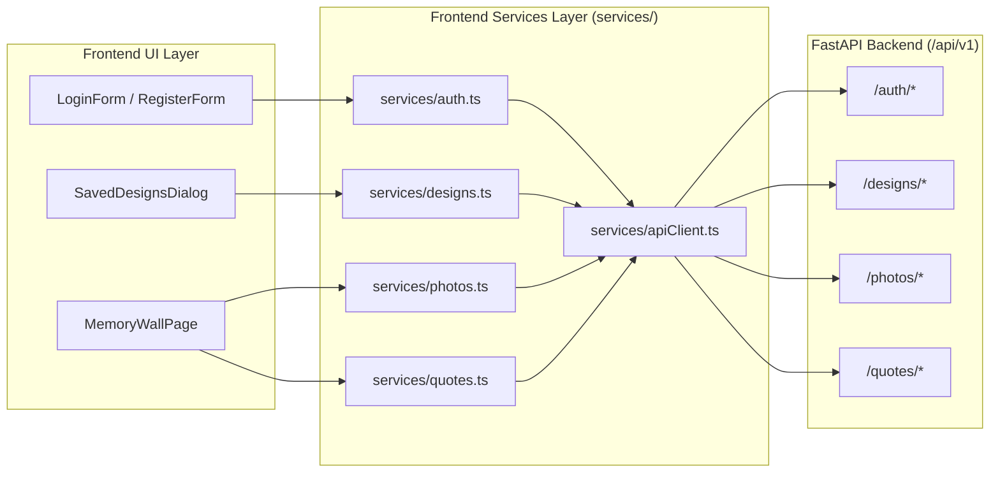
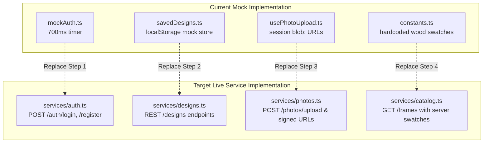
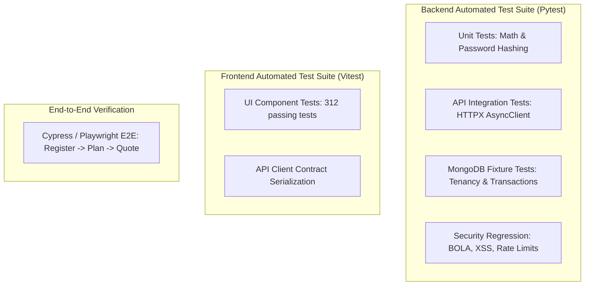

# Phase 9: Frontend–Backend Integration, Testing & Deployment Strategy

**Project:** SAF Studio Full-Stack Platform  
**Target Environment:** Local Development & Production Containerized Deployment  
**Test Frameworks:** Pytest (Backend), Vitest & Testing Library (Frontend)  
**Date:** November 7, 2026

---

## 1. Frontend–Backend Integration Architecture

The frontend is specifically prepared for Phase 5 live API connection. Connecting the frontend to the FastAPI backend requires systematic replacement of mock stores and stub implementations without altering UI layout or design tokens.



---

## 2. Comprehensive Traceability Matrix: Action to Storage

For every major customer feature, the exact execution lifecycle is mapped:

| Step # | Frontend Component | User Action | Triggered API Endpoint | Backend Service Layer | Target MongoDB Collection | Wire Response | Resulting UI Update |
|---|---|---|---|---|---|---|---|
| **INT-01** | `RegisterForm.tsx` | Enters details & clicks "Create Account" | `POST /api/v1/auth/register` | `AuthService.register()` | `users`, `refresh_tokens` | `201 Created` with User & Tokens | Stores access token in memory, sets refresh cookie, navigates to `/memory-wall` |
| **INT-02** | `LoginForm.tsx` | Enters identifier & clicks "Sign In" | `POST /api/v1/auth/login` | `AuthService.login()` | `users`, `refresh_tokens` | `200 OK` with User & Tokens | Stores session, navigates to `/memory-wall` |
| **INT-03** | `PlannerHeader.tsx` | Clicks "Sign Out" in ProfileMenu | `POST /api/v1/auth/logout` | `AuthService.logout()` | `refresh_tokens` | `204 No Content` | Clears memory tokens, notifies other tabs, redirects to `/login` |
| **INT-04** | `TemplatesDialog.tsx` | Opens dialog & selects category | `GET /api/v1/templates?category=grid` | `TemplateService.list()` | `layout_templates` | `200 OK` with template cards | Renders template cards with live compatibility indicators |
| **INT-05** | `FrameSelectionPanel.tsx` | Selects local photo file for frame | `POST /api/v1/photos/upload` | `PhotoService.process_upload()` | `photos` + Disk Storage | `201 Created` with Photo metadata & signed URLs | Frame updates with thumbnail; DPI indicator shows print quality badge |
| **INT-06** | `WallConfigPanel.tsx` | Changes wall dimensions | `POST /api/v1/geometry/validate-layout` | `GeometryService.validate()` | Stateless | `200 OK` with bounds & coverage % | Updates SVG wall boundary lines & warning badges |
| **INT-07** | `SaveDesignDialog.tsx` | Enters title & clicks "Save Design" | `POST /api/v1/designs` followed by `POST /api/v1/designs/{id}/versions` | `DesignService.create_with_version()` | `designs`, `design_versions` | `201 Created` with Version Summary | Closes dialog, shows success toast with "View in Saved" action |
| **INT-08** | `SavedDesignsDialog.tsx` | Opens "My Saved Templates" | `GET /api/v1/designs` | `DesignService.list_user_designs()` | `designs` | `200 OK` with design summaries | Renders grid of saved design cards with SVG previews |
| **INT-09** | `SavedDesignsDialog.tsx` | Clicks "Open Design" card | `GET /api/v1/designs/{id}` | `DesignService.get_detail()` | `designs`, `design_versions` | `200 OK` with full version items | Dispatches `design/load` action, restoring complete wall canvas state |
| **INT-10** | `SavedDesignsDialog.tsx` | Clicks trash icon on design card | `DELETE /api/v1/designs/{id}` | `DesignService.soft_delete()` | `designs` | `204 No Content` | Removes design card immediately, shows Undo toast |
| **INT-11** | `ActionBar.tsx` | Clicks "Request a Quote" & submits form | `POST /api/v1/quotes` | `QuotationService.create_quote()` | `quotes` | `201 Created` with Quote Number & Expiry | Shows Quote Confirmation modal with reference number (e.g. `QT-2026-0042`) |

---

## 3. Mock Replacement Strategy

The phased migration from mock modules to live services:



### Detailed Replacement Plan:
1. **Authentication (`features/auth/lib/mockAuth.ts` -> `services/auth.ts`):**
   - Implement `services/auth.ts` containing `login()`, `register()`, `logout()`, `getMe()`.
   - Update `useLoginForm.ts` and `useRegisterForm.ts` to call live services.
   - Introduce silent refresh interceptor inside `apiClient.ts` to refresh tokens seamlessly upon 401.
2. **Saved Designs (`features/memory-wall/lib/savedDesigns.ts` -> `services/designs.ts`):**
   - Replace `savedDesignsStore` localStorage operations with asynchronous calls to `GET /api/v1/designs`, `POST /api/v1/designs`, and `DELETE /api/v1/designs/{id}`.
   - Maintain the existing `SavedDesign` interface so React components (`SavedDesignsDialog.tsx`) require zero visual modifications.
3. **Photo Uploads (`features/memory-wall/hooks/usePhotoUpload.ts` -> `services/photos.ts`):**
   - Replace client-only `URL.createObjectURL(file)` with multipart POST to `/api/v1/photos/upload`.
   - Use the returned signed `thumbnail_url` and `preview_url` in the `PhotoRef` state.
4. **Moulding Finishes (`constants.ts` -> `services/catalog.ts`):**
   - Fetch moulding swatches from `GET /api/v1/frames`, falling back to `WOOD_FINISHES` if offline.

---

## 4. Comprehensive Testing Strategy



### 4.1 Backend Test Coverage Requirements
1. **Unit Tests (`tests/test_unit.py`):**
   - Pure math tests for geometry layouts: Invariants across all 4 layout styles (`grid`, `salon`, `centre`, `row`), ensuring zero overlaps and bounds preservation.
   - Pricing calculations: Exact paisa accuracy across varying frame dimensions, mat widths, and glazing tiers.
   - Password hashing and token generation: Constant-time comparison verification.
2. **API & Database Integration Tests (`tests/test_api.py`):**
   - Executed against an isolated test database (e.g., `saf_studio_test`).
   - Registration conflict tests: 409 Conflict with field error assertion.
   - Multi-identifier login: Verifies login via both email and E.164 phone.
   - Token refresh rotation: Asserts that presenting a rotated token revokes the family.
   - Decompression bomb defense: Uploading a malicious high-pixel image fails safely with 422.
3. **Security & BOLA Regression Suite (`tests/test_security.py`):**
   - Tenancy isolation: User A cannot read or modify User B's design (asserts 404).
   - Rate limiting: 6th login attempt within 1 minute returns HTTP 429.
   - NoSQL injection: Attempting MongoDB injection payloads (e.g. `{"$gt": ""}`) in query fields fails validation.
4. **Contract Verification:**
   - FastAPI generates `openapi.json`. An automated script asserts 1:1 structural parity with TypeScript interfaces in `frontend/src/types/api/*`.

---

## 5. Deployment, Containerization & CI/CD Strategy

### 5.1 Docker Architecture

#### Backend Multi-Stage Dockerfile (`backend/Dockerfile`):
```dockerfile
# Stage 1: Build dependencies
FROM python:3.12-slim AS builder
WORKDIR /app
RUN apt-get update && apt-get install -y --no-install-recommends gcc libpq-dev && rm -rf /var/lib/apt/lists/*
RUN pip install --no-cache-dir uv
COPY pyproject.toml .
RUN uv pip compile pyproject.toml -o requirements.txt && \
    uv pip install --no-cache-dir --prefix=/install -r requirements.txt

# Stage 2: Production runtime
FROM python:3.12-slim AS runner
WORKDIR /app
RUN apt-get update && apt-get install -y --no-install-recommends libmagic1 && rm -rf /var/lib/apt/lists/*
COPY --from=builder /install /usr/local
COPY . /app

# Non-root security user
RUN useradd -m -u 1000 appuser && chown -R appuser:appuser /app
USER appuser

EXPOSE 8000
CMD ["uvicorn", "app.main:app", "--host", "0.0.0.0", "--port", "8000", "--workers", "4", "--proxy-headers"]
```

#### Production Orchestration (`docker-compose.prod.yml`):
```yaml
version: "3.8"

services:
  backend:
    build:
      context: ./backend
      dockerfile: Dockerfile
    restart: always
    environment:
      - MONGODB_URL=mongodb://mongo:27017
      - DATABASE_NAME=saf_studio
      - SECRET_KEY=${SECRET_KEY}
      - MEDIA_ROOT=/app/data/media
    volumes:
      - media_data:/app/data/media
    depends_on:
      - mongo
    ports:
      - "8000:8000"

  mongo:
    image: mongo:7.0
    restart: always
    volumes:
      - mongo_data:/data/db
    command: ["--wiredTigerCacheSizeGB", "1.5"]

volumes:
  mongo_data:
  media_data:
```

### 5.2 CI/CD Automation Pipeline (GitHub Actions)
```yaml
name: Backend CI/CD Pipeline

on:
  push:
    branches: [main, develop]
  pull_request:
    branches: [main]

jobs:
  test:
    runs-on: ubuntu-latest
    services:
      mongodb:
        image: mongo:7.0
        ports:
          - 27017:27017
    steps:
      - uses: actions/checkout@v4
      - name: Set up Python 3.12
        uses: actions/setup-python@v5
        with:
          python-version: "3.12"
      - name: Install dependencies
        run: |
          pip install uv
          uv pip install -e ".[test]"
      - name: Lint and Format Check
        run: |
          ruff check .
          ruff format --check .
      - name: Run Pytest Suite with Coverage
        run: |
          pytest --cov=app --cov-report=xml --cov-fail-under=85
      - name: Security Vulnerability Scan
        run: |
          pip-audit
```

### 5.3 Automated Database Backup & Retention
1. **Nightly Backups:** Run via `mongodump --gzip --archive=/backups/saf_studio_$(date +%Y%m%d).gz`.
2. **Offsite Synchronization:** Encrypted archives pushed to cold object storage (AWS S3 Glacier or equivalent).
3. **Retention Policy:**
   - Daily backups retained for 30 days.
   - Monthly backups retained for 1 year.
   - Annual quotation archives retained for 7 years (tax and audit compliance).

